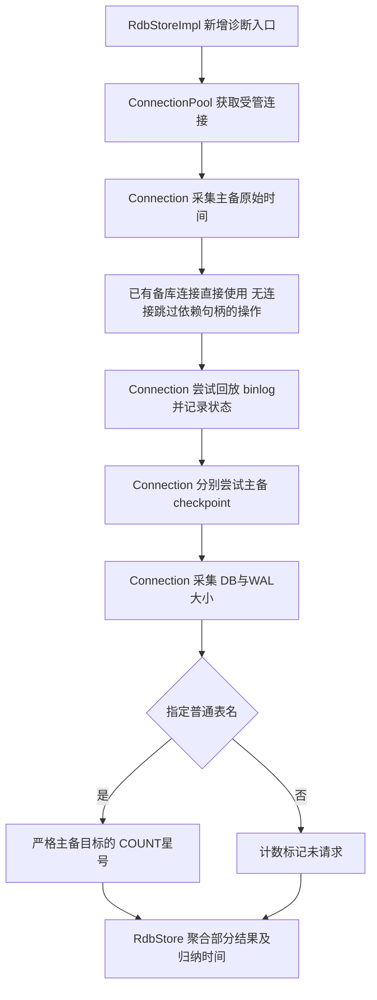
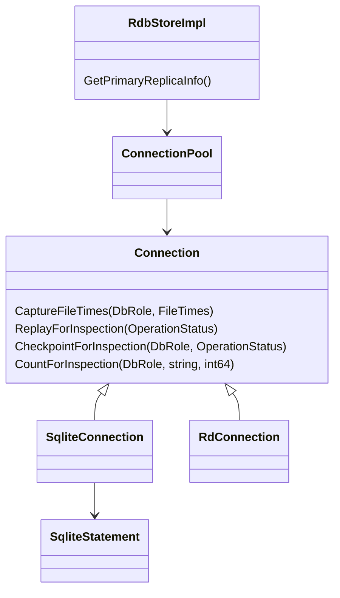
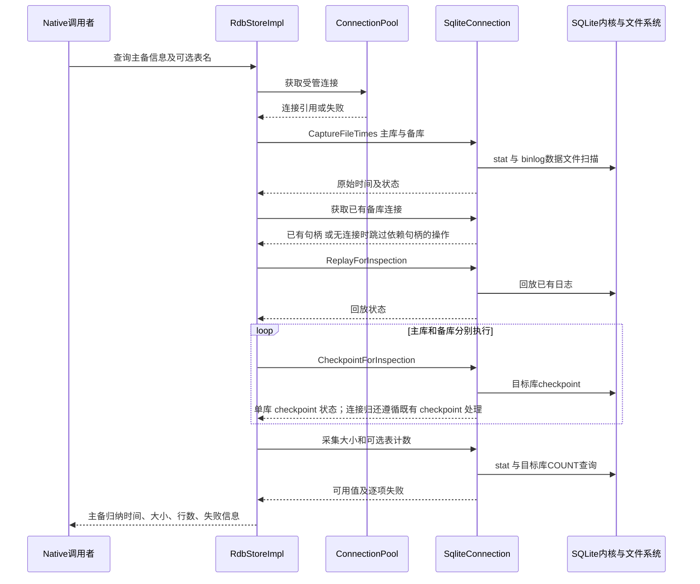
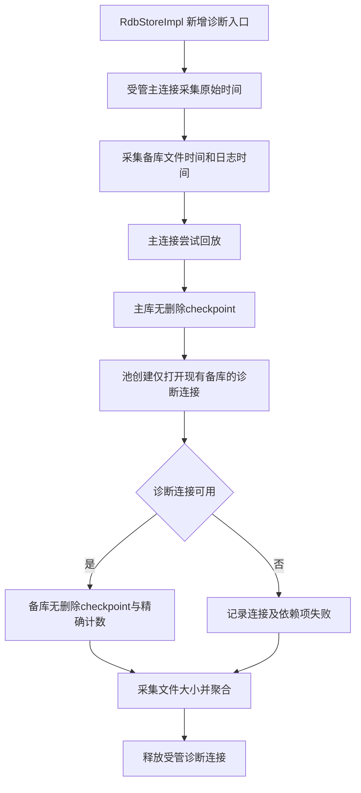
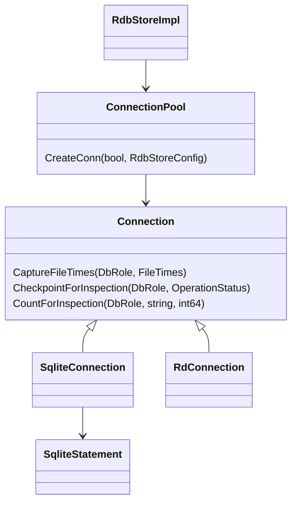
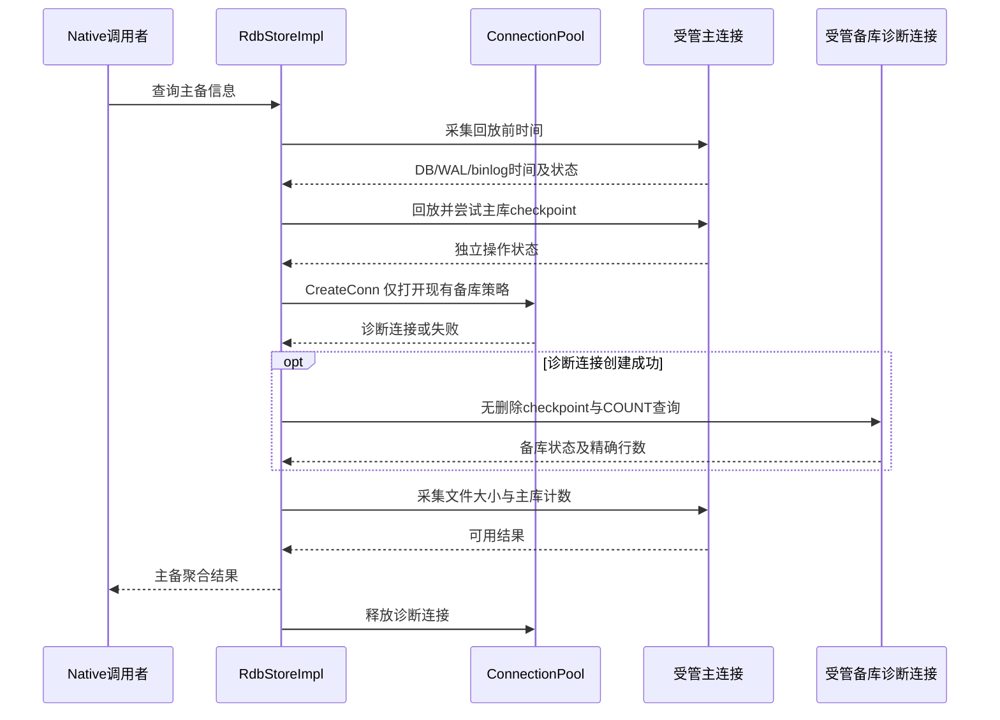

# 可行性分析

## 1. 目标与范围

评估在 relational_store 中新增 Native C++ 主备库诊断接口的可行性。输入为 [01-requirement.md](01-requirement.md) 中已确认的 FR-01～FR-10，以及 [_draft/feasibility-inputs.md](_draft/feasibility-inputs.md) 中记录的用户指定源码。正式归档信息按用户要求暂缓；本报告为技术分析草稿，不宣称需求正式定稿或版本归档完成。

确认的业务顺序：先采集主备 DB/WAL 文件修改时间和 binlog 最新修改时间，再尝试回放存在的 binlog，分别尝试主备 checkpoint，最后采集 DB/WAL 大小及可选普通表的精确行数。Connection 提供原始时间；按用户在本阶段的修正，RdbStore 主库时间始终取主库 DB/WAL 较大值，备库有关联 binlog 时取最新 binlog 时间，否则取备库 DB/WAL 较大值。时间为 Unix 毫秒，大小按文件字节数评估。

支持 MAIN_REPLICA、MANUAL_TRIGGER 和已有加密能力；查询不主动恢复或重建。允许并发写入、不同采样时点和部分失败，失败信息必须出现在结果中。本次不涉及性能指标，不设置耗时门槛。本文不会把“允许并发”解释成底层完全不发生锁等待。

输入证据状态：关键接口和调用链已静态读取当前工作树，[代码证据](_draft/code-evidence.md)提供接口签名和源码位置。没有执行新接口 PoC、UT 或目标设备验证；运行语义、目标版本 ABI、内核文件命名和部分特殊场景仍是有条件项。

## 2. 技术可行性

### 2.1 关键代码仓库分析

| 仓库/模块 | 路径 | 关键接口 | 影响类型 | 证据来源 |
|-----------|------|----------|----------|----------|
| relational_store / inner_api | interfaces/inner_api/rdb/include/rdb_store.h、rdb_store_config.h | RdbStore::Count、HAMode | 新增内部查询入口和返回结构；存量行为保持 | E-09、E-17 |
| relational_store / RdbStoreImpl | frameworks/native/rdb/src/rdb_store_impl.cpp | Count、ExecuteAndGetLong、GetStatement | 新增编排路径；避免复用恢复分支 | E-09、E-10 |
| relational_store / 连接抽象 | frameworks/native/rdb/include/connection.h、statement.h | ReplayBinlog、TryCheckPoint、CreateReplicaStatement、ExecuteForValue | 新增连接级诊断能力，不改变存量方法含义 | E-04、E-05、E-07、E-15 |
| relational_store / SQLite | frameworks/native/rdb/src/sqlite_connection.cpp | ReplayBinlogSqlite、InnerOpenSlave、InnerCreate | 可复用内核调用；诊断路径补充严格来源与状态返回 | E-04～E-08、E-12 |
| relational_store / 工具与 DFX | frameworks/native/rdb/src/sqlite_utils.cpp、rdb_db_info_manager.cpp | Stat、GetSlavePath、GetBinlogFolderPath、CollectBinlog | 路径和文件采集复用；增加最新数据日志时间与逐项失败表达 | E-01～E-03、E-13、E-14、E-18 |
| relational_store / 连接池 | frameworks/native/rdb/src/connection_pool.cpp | AcquireConnection、CreateConn | 管理连接生命周期；候选 B 涉及受管临时连接 | E-11、E-12 |
| relational_store / RD | frameworks/native/rd/src/rd_connection.cpp | TryCheckPoint | 新接口默认不支持；不引入 SQLite 行为 | E-16 |
| 本地 SQLite 配套内核 | mock/sqlite/include/sqlite3sym.h、src/sqlite3.c | sqlite3_replay_binlog、sqlite3_wal_checkpoint_v2 | 既有依赖；验证扩展可用性，不新增第三方依赖 | E-04、E-18 |

上述“影响”是候选设计的改动范围，接口尚未实现。用户于 2026-10-08 明确“需求实现可以修改源码”，本需求获准在当前 feature/mock-test-fixes 分支修改 relational_store 源码并保留已有变更；正式目标版本归档仍暂缓。

### 2.2 按子能力分析现有差距

| 子能力 | 价值与 FR | 可复用能力及签名 | 缺口 | 兼容性、安全、依赖 | 性能与可行性 |
|--------|-----------|------------------|------|--------------------|--------------|
| C1 文件元数据 | DB/WAL 大小、回放前时间；FR-02/03/08 | `SqliteUtils::Stat(const std::string &) -> pair<int32_t, RdbDebugInfo>`；配置版主备/binlog 路径解析 | 最新 binlog 数据文件筛选；毫秒折算；区分缺失、权限失败和扫描失败 | 保留 Stat/Collect 行为；只采集已绑定库路径，排除目录和辅助索引文件；不导出密钥 | 性能不在验收范围；文件采集基础可行，日志路径与文件筛选需验证 |
| C2 回放与 checkpoint | 采集前整理持久化状态；FR-05/06/07 | `ReplayBinlogSqlite(sqlite3 *, sqlite3 *, const RdbStoreConfig &) -> int`；内核 checkpoint | 存量 `ReplayBinlog(config, bool)` 为 void；`TryCheckPoint(bool) -> int` 隐藏备库错误且会删损坏库；需要独立状态和无删除路径 | 保留旧接口；SQLite 调用留在 SqliteConnection；管理句柄寿命和并发锁；加密库现有 binlog 不支持 | 不设置耗时目标；锁冲突作为结果；有条件可行 |
| C3 主备精确计数 | 普通表记录量对比；FR-04/07/09 | `Statement::ExecuteForValue(const vector<ValueObject> &) -> pair<int, ValueObject>`；SQL COUNT(*) | 必须严格选定主/备句柄；不能直接依赖 CreateReplicaStatement 名称；不能走 GetStatement 的自动恢复分支 | 标识符正确引用/验证；单库查询快照；使用 64 位计数；临时连接纳入池；不读数据内容到结果 | 不设置大表耗时阈值；精确查询基础可行，特殊连接状态有条件 |
| C4 聚合与部分结果 | Native 输出归纳时间和逐项状态；FR-01/03/07 | RdbStoreImpl、已有错误码、结果值类型 | 当前没有本接口结果结构；需要可用性与各操作状态，不能用有效 0 掩盖错误 | 新增路径保持存量返回码；接口类型不含 sqlite3 指针；RD 默认不支持；无 JS/NDK 新绑定 | 性能不在范围；主库 max(DB/WAL)、备库 binlog 优先的规则已确认 |

关键现有调用链：

```text
Count(out, predicates)
  -> BuildCountString(predicates)
  -> ExecuteAndGetLong(out, sql, args)
  -> BeginExecuteSql / GetStatement
  -> Connection::CreateStatement 或恢复分支 CreateReplicaStatement
  -> Statement::ExecuteForValue

ReplayBinlog(config, chkBinlogCount) [void]
  -> ReplayBinlogSqlite(masterHandle, slaveHandle, config) [int]
  -> sqlite3_replay_binlog
  -> 成功时 clean_binlog；错误只记录日志

TryCheckPoint(timeout) [int]
  -> 本库 sqlite3_wal_checkpoint_v2(TRUNCATE)
  -> 退出时备库 TryCheckPoint
  -> 备库 CORRUPT 时 DeleteCorruptSlave
```

因此不能把现有 Count、ReplayBinlog、TryCheckPoint 和 CreateReplicaStatement 简单串接后宣称需求实现完成。既有行为作为事实保留，新增能力使用自己的严格来源、错误回传和无自动恢复路径。

### 2.3 候选 A：使用现有主连接及其备库句柄

RdbStoreImpl 负责整个诊断顺序，Connection 扩展单阶段的连接级操作。通过连接池持有主连接，SqliteConnection 在内部对本库与其 `slaveConnection_` 执行明确目标的操作。已有备库连接直接复用；无连接时不尝试打开，跳过依赖备库句柄的回放、checkpoint 和计数，保留主库及其他可用结果。文件采集与连接可用性分别记录，不将缺少连接等同于文件不存在，不调用 FORCE_OPEN/InnerOpenSlave 的损坏删除重建分支。

候选新增签名，仅用于范围估算，不是已定稿 API：

```cpp
// DbRole、FileTimes、FileSizes、OperationStatus 为候选值类型。
virtual int CaptureFileTimes(DbRole role, FileTimes &out);
virtual int ReplayForInspection(OperationStatus &out);
virtual int CheckpointForInspection(DbRole role, OperationStatus &out);
virtual int CaptureFileSizes(DbRole role, FileSizes &out);
virtual int CountForInspection(DbRole role, const std::string &table, int64_t &out);
```

时间字段包含 DB/WAL/binlog 三个原始值及各自的可用性。大小、计数和维护操作分别保存状态；“未指定表名”“不存在 WAL/binlog”“失败”不能全部压缩成同一个零值。RdbStore 主库只归纳 DB/WAL，备库优先使用其关联 binlog；归纳仅使用可用值，binlog 扫描失败不能被解释为确定没有 binlog。源库向备库回放使用的日志路径由源配置解析，不能因日志物理目录与备库相邻而改用备库文件名拼接另一目录。





本次是进程内 Native 调用，无新增 IPC。时序图展示进程内协作：



分子能力判断：C1 可行；C2 有条件可行，新增能返回状态的无删除维护操作及缺句柄时的跳过处理；C3 有条件可行，必须绕开备库语句的来源歧义并验证已有备库句柄及无句柄时的跳过行为；C4 可行，按已确认的主备时间规则聚合。组合路径为有条件可行。

### 2.4 候选 B：池管理的独立备库诊断连接

保持 RdbStoreImpl 编排和 Connection 原始时间输出边界；主库回放使用已有连接，备库 checkpoint/计数采用由 ConnectionPool::CreateConn 管理的独立诊断连接。增加打开现有备库且不创建、不恢复、不重建的连接策略，复制既有加密参数，严格绑定真实备库路径。不能直接使用现有的非 SINGLE 写连接创建路径，否则会再次创建备库及配置 binlog；也不能用只读连接执行写入性质的 checkpoint。

候选 A 的连接级采集/维护接口仍适用；候选 B 额外评估诊断打开策略与池集成：

```cpp
// 现有接口，临时连接必须走此生命周期管理。
std::pair<int32_t, SharedConn> CreateConn(bool isWriter, const RdbStoreConfig &config);
// 候选扩展：增加明确的仅打开现有库的诊断策略；保持存量默认策略。
```







分子能力判断：C1 可行；C2 有条件可行，需诊断打开策略和无删除 checkpoint；C3 有条件可行，独立来源更明确，但要验证加密、压缩 VFS、生命周期及打开副作用；C4 可行，按已确认的主备时间规则聚合。组合路径为有条件可行。

### 2.5 兼容、安全与验证边界

保持 RdbStoreImpl → ConnectionPool → Connection → Statement 分层；上层不直接持有 sqlite3 指针。新增连接虚接口评估二进制兼容和所有实现后端；不修改旧 ReplayBinlog 返回类型、不修改旧 TryCheckPoint 的故障处理语义、不修正旧 CreateReplicaStatement 的行为来完成本需求。

已有 SQLite 依赖可以承载两候选，不引入新静态库或新服务。新接口为 Native 内部接口，不新增 JS、ETS、NDK 绑定，但要验证新增 inner_api 类型/符号对现有构建的影响。若新增导出头文件，必须同步 bundle.json；优先复用现有标准错误码，不通过修改存量接口返回码表达诊断失败。

加密支持采用既有密钥配置。E-13 说明当前加密库不启用 binlog；正常没有日志时使用 DB/WAL 时间。若日志存在但内核不支持回放，应保留文件时间和大小，回放状态明确不支持，而不是删除遗留日志。

统计普通表需要验证该对象确为普通表并正确引用标识符。不能未经校验直接拼接表名，也不能将只有一列的 COUNT 结果集“行数 1”当成目标表行数；应读取 COUNT(*) 的 64 位标量。

| 验证项 | 对应能力 | 可观察标准 | 阶段与角色 |
|--------|----------|------------|------------|
| 时间顺序与毫秒折算 | C1/C4 | 可控文件时间；checkpoint 后变化不覆盖保存的回放前时间；毫秒按 sec×1000+nsec/1000000 | 实现 UT，模块开发者 |
| 真正主备来源 | C3 | 两库插入不同已知行数；备库句柄已存在或未初始化时都不返回主库伪造值 | 实现 UT，模块开发者 |
| 回放与 checkpoint 独立失败 | C2/C4 | 分别注入回放失败、主库/备库 BUSY、CORRUPT；结果含各失败且可用指标仍返回 | 实现 UT，测试维护者 |
| 不主动恢复/重建 | C2/C3 | 诊断查询不主动打开、创建或重建备库；checkpoint 错误按状态返回，连接归还沿用既有处理 | 实现 UT，模块开发者 |
| 备库连接可用性 | C2/C3 | 已有连接直接复用；无连接时无论文件是否存在均不尝试打开，跳过依赖句柄的操作，保留主库可用信息；文件采集错误单独记录 | 实现 UT，模块开发者 |
| 可选计数与安全表名 | C3 | 未请求、空表 0 行、缺表、带引号或非法标识符分别符合确定的状态；读取标量而非结果集行数 | 实现 UT，测试维护者 |
| binlog 数据筛选与归属 | C1/C4 | 多个日志文件取最新 mtime；排除 readIndex/锁/目录；主库时间不受binlog影响，备库有关联日志时优先日志时间 | 文件筛选在详细设计定义，内核维护角色；实现 UT |
| 两主备模式、加密与自定义目录 | C1/C2/C3 | 支持正常主备路径；加密无日志仍有可用指标；自定义目录不落到默认路径 | UT与设备集成，模块开发者 |
| 并发与资源寿命 | 全部 | 并发写入时不全局冻结；锁冲突有状态；返回后无游离临时连接、无旧句柄访问 | 实现 UT，模块开发者 |
| 兼容及真实构建 | C4 | 目标版本编译与存量 UT；非 SQLite 默认不支持；新增符号/导出符合目标 ABI 约束 | 实现阶段，构建与模块维护角色 |

## 3. 竞品参考

本需求不是竞品功能对标，未将未经验证的产品作为决策依据。以下为直接支撑能力判断的基础方案参考：

| 竞品/方案 | 做法 | 可借鉴点 | 来源链接 |
|-----------|------|----------|----------|
| SQLite checkpoint API | 指定数据库和模式执行 checkpoint，返回状态和可选帧数 | 逐库返回状态；并发下 checkpoint 不保证完成，TRUNCATE 与 PASSIVE 的锁语义不同 | [官方 checkpoint 文档](https://www.sqlite.org/c3ref/wal_checkpoint_v2.html) |
| SQLite COUNT(*) | 返回查询集合总行数 | 精确计数读取标量；按各库查询快照理解结果 | [官方聚合函数文档](https://www.sqlite.org/lang_aggfunc.html#count) |

以上只支持 SQLite 基础语义，不证明当前工作树的 OpenHarmony binlog 扩展和新接口已经运行验证。

## 4. 成本与收益

工作量为分析区间，不是已测量代码量或排期承诺。按技能统一口径：开发 500 行约 1 人月；测试为开发×0.3，设计为开发×0.1；本次没有 UX，合计开发×1.4。代码行数只估算新增/调整生产代码，测试工作以倍率另外计算。

估算依据为 [§2.2 子能力差距](#22-按子能力分析现有差距)和 [代码证据](_draft/code-evidence.md)：采集、日志过滤、单阶段状态接口、严格主备目标、部分结果、后端默认行为分别需要小方法；A 复用已有备库连接并处理缺句柄时的跳过状态；B 另需安全打开策略、独立连接配置及池集成。修改点不是简单增加一个文件 stat 调用。

| 子能力 | A 估算生产代码行数 | B 估算生产代码行数 | 行数依据 |
|--------|------------------|------------------|----------|
| C1 文件元数据 | 100～140 | 100～140 | DB/WAL采样、binlog数据过滤与最大mtime、路径解析、状态/毫秒处理 |
| C2 无删除维护操作 | 260～420 | 240～320 | 有状态回放、逐库checkpoint、可用性检查与缺句柄时的跳过状态；B另需仅打开现有库策略 |
| C3 精确计数与连接来源 | 140～200 | 260～360 | 普通表验证、标识符引用、严格目标、64位结果；B另有临时连接配置/释放 |
| C4 Native聚合与后端兼容 | 100～140 | 160～220 | 结果类型、入口编排、归纳规则、逐项错误、非SQLite默认行为；B另有生命周期集成 |
| 合计 | 600～900 | 760～1040 | 各子能力相加；不含需求外的旧缺陷修复 |

各方案工作量对比汇总：

| 候选路径 | 生产代码行数 | 开发人月 | 测试人月 | 设计人月 | UX人月 | 端到端人月 |
|----------|--------------|----------|----------|----------|--------|------------|
| A 复用主连接持有的已有备库句柄 | 600～900 | 1.2～1.8 | 0.36～0.54 | 0.12～0.18 | 0 | 1.68～2.52 |
| B 受管独立备库诊断连接 | 760～1040 | 1.52～2.08 | 0.456～0.624 | 0.152～0.208 | 0 | 2.128～2.912 |

预期可验证收益：一次接口调用提供两库各自两项文件大小、一个归纳时间和可选的一项精确计数；调用者能够区分有效值和失败，不需要自行接触库文件/SQLite句柄。以上是结果覆盖数量，不是性能收益；不能用这些指标相同证明数据库内容完全相同。没有成本、成功率或收益的实测基线。

## 5. 风险

以下 Owner 是验证责任角色，具体人员未指定；关闭时点是所需交付节点，不是日期承诺。

| 风险 | 子能力/路径 | 等级 | 缓解措施与验证动作 | Owner角色 | 关闭时点 | 阻塞性 |
|------|-------------|------|--------------------|-----------|----------|--------|
| 旧备库语句方法可能读到主库 | C3 / A | 高 | 新接口严格绑定实际备库句柄；主备不同计数及备库句柄已存在的用例验证 | 模块开发者 | 实现合入前 | 阻塞A正确计数 |
| checkpoint 错误处置与诊断返回 | C2/C3 / A、B | 中 | 验证 checkpoint 状态独立返回；连接归还沿用既有 TryCheckPoint 错误处理，不新增恢复/重建逻辑 | 模块开发者 | 详细设计及合入前 | 阻塞状态回传 |
| 回放失败被void接口吞掉，备库checkpoint状态未传出 | C2/C4 / A、B | 高 | 新增有状态的操作；不修改旧签名；分别注入错误 | 模块开发者 | 详细设计及合入前 | 阻塞部分失败契约 |
| 备库归纳时间可能来自尚未回放的关联日志，不能当作备库已落盘时间 | C1/C4 / A、B | 中 | 按用户确认规则主库只看DB/WAL，备库binlog优先；接口说明区分逻辑变更时间与回放状态 | 模块开发者 | 返回结构与接口说明定稿前 | 时间归属已确认，需文档及UT落实 |
| binlog辅助文件或扫描失败污染最新时间 | C1 / A、B | 中 | 验证日志命名规则，排除readIndex/锁/目录；错误与不存在分开表达 | 内核维护角色 | 详细设计及UT前 | 阻塞日志时间正确性 |
| 新增打开路径触发创建/初始化或加密配置不一致 | C2/C3 / B | 高 | B采用仅打开现有库策略并纳入池管理；验证缺库、并发删除、密钥、压缩VFS及文件变化 | 模块开发者 | 详细设计及PoC前 | 阻塞B路径 |
| 并发写入使主备指标来自不同状态 | 全部 / A、B | 低 | 按已确认的分别采样语义解释，保留各状态；不输出未经定义的一致性结论 | 模块开发者 | 返回结构定稿前 | 不阻塞，行为已接受 |
| 允许并发与checkpoint锁产生冲突 | C2 / A、B | 中 | 不全局冻结；分别返回BUSY/失败状态，不承诺checkpoint必成或零锁等待 | 模块开发者 | 实现UT前 | 不阻塞，需错误覆盖 |
| 新增Connection虚接口影响后端/ABI | C4 / A、B | 中 | 保持旧接口语义；非SQLite默认不支持；目标版本构建及ABI核对 | 模块与构建维护角色 | 合入前 | 阻塞发布 |
| 当前mock验证环境与正式目标环境存在差异 | 全部 / A、B | 中 | 按用户授权在当前分支实现并执行本地验证；正式目标版本确定后重新核对构建、ABI与设备行为 | 模块与构建维护角色 | 正式发布前 | 不阻塞本仓实现，目标环境验证未完成 |

## 6. 结论建议

| 候选路径 | 可行性判断 | 事实依据 | 风险状态 | 定稿条件 |
|----------|------------|----------|----------|----------|
| A 复用主连接持有的已有备库句柄 | ⚠️ 有条件可行 | [现有能力差距](#22-按子能力分析现有差距)与[候选A](#23-候选-a使用现有主连接及其备库句柄)：文件采集、回放内核和标量计数已有基础，但不能直接组合旧接口；方案A仅复用已有备库连接，无连接时跳过依赖句柄的操作 | 🔴高风险：错误丢失、错误库来源与损坏删除；以新增严格目标、跳过状态和无删除操作控制 | 主备时间规则与本仓源码修改授权已确认；定义逐项状态；验证日志筛选、已有句柄、无连接跳过与故障行为 |
| B 受管独立备库诊断连接 | ⚠️ 有条件可行 | [候选B](#24-候选-b池管理的独立备库诊断连接)：池管理临时连接基础存在，但安全打开策略、加密/压缩配置与无删除维护需补齐 | 🔴高风险：打开副作用及密钥/VFS配置；以仅打开现有库策略和故障验证控制 | A的公共状态与验证条件，加上诊断连接创建策略与PoC |

本报告提供两条路径的可行性依据。选定方案 A，连接策略遵循 FR-10；选型记录见 [03-arch-decision-record.md](03-arch-decision-record.md)，正式遗留项责任与关闭时间尚未归档。工作量见[成本与收益](#4-成本与收益)，运行验证边界见[兼容、安全与验证边界](#25-兼容安全与验证边界)。新接口尚未实现，静态证据不等于编译、UT或目标设备验证。
