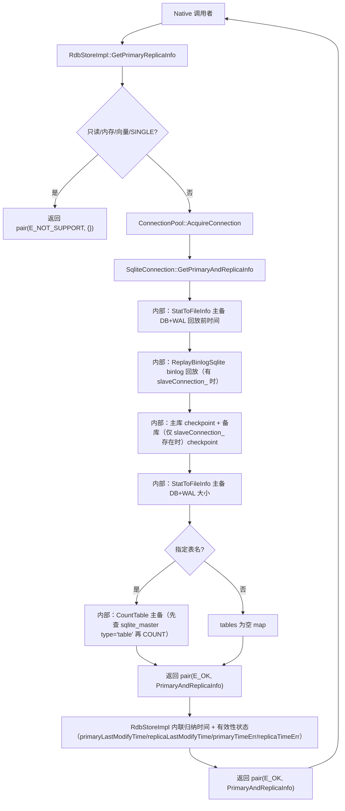
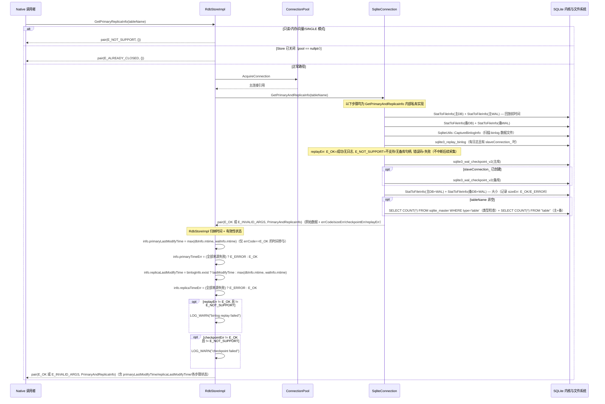

# Design: relational_store 主备库信息查询接口

## 需求基线摘要

本设计实现 [04-feature.md](04-feature.md) AC-01～AC-10 和 [05-spec.md](05-spec.md) 验收标准。核心诉求：在 relational_store 中新增 Native C++ 内部接口，一次调用获取主备库各自的 DB/WAL 文件大小、归纳修改时间、可选普通表精确行数，并返回各步骤的独立状态和失败信息。

选定方案 A（见 [03-arch-decision-record.md](03-arch-decision-record.md)）：复用主连接已有的备库句柄（slaveConnection_）；无备库连接时不打开备库，备库 DB 按配置路径 stat，WAL 跳过（E_NOT_SUPPORT）。不采用方案 B 的独立诊断连接。

## 代码事实基线

> 以下为直接读取工作树得到的事实，来源见 [_draft/code-evidence.md](_draft/code-evidence.md)。路径和行号对应分析时的工作树。

| 事实项 | 代码引用（文件:行） | 对设计的约束 |
|--------|-------------------|-------------|
| `SqliteUtils::Stat(path) → pair<int32_t, RdbDebugInfo>` | sqlite_utils.cpp:996 | 返回 size/mtime；秒+纳秒可折算毫秒；**上游限制**：失败时统一返回 E_ERROR，不区分权限(E_SQLITE_PERM)/I/O(E_SQLITE_IOERR)，区分 errno 为未来增强 |
| `GetSlavePath(config)` / `GetBinlogFolderPath(config)` | sqlite_utils.cpp:677,695 | 均支持自定义 replicaPath，不能仅拼接主库默认相邻路径 |
| `ReplayBinlog(config, bool)` 为 void | connection.h:114; sqlite_connection.cpp:2377 | 公开虚方法 void，内部得到 int 但不传出；新接口须返回状态 |
| `TryCheckPoint(bool) → int` | sqlite_connection.cpp:1431 | RAII 结束时可能再试备库 checkpoint；备库 CORRUPT 时既有路径会调用 DeleteCorruptSlave；新接口记录独立 checkpoint 状态，连接归还保持既有处理语义 |
| `DeleteCorruptSlave(path)` | sqlite_connection.cpp:2506 | 清空 slaveConnection_、删除备库、部分分支删除 binlog 目录；这是既有损坏处理路径，诊断接口不新增或改变该处理语义 |
| `CreateReplicaStatement` 局部 db 初始为主库句柄 | sqlite_connection.cpp:661 | 仅在 slaveConnection_ 为空且 FORCE_OPEN 成功时改为备库；不能仅凭方法名保证来源 |
| `InnerOpenSlave` / `InnerCreate` 含 SQLITE_OPEN_CREATE | sqlite_connection.cpp:232,270,2083 | CORRUPT 时删除备库；写连接非 SINGLE 会创建备库；诊断路径须避免这些路径 |
| `CheckDbNotExist` / `InnerOpen` | sqlite_connection.cpp:333,353,369 | 不允许创建的配置只影响 access 预检；打开标志仍含 SQLITE_OPEN_CREATE |
| `Count(out, predicates) → int` | rdb_store_impl.cpp:2001 | 现有 Count 走 BuildCountString → ExecuteAndGetLong；无主备结果参数 |
| `GetStatement(sql, conn, returning)` | rdb_store_impl.cpp:3350 | 恢复标记处理分支可能触发异步恢复；诊断入口不得走此分支 |
| `RdConnection::TryCheckPoint(bool)` | rd_connection.cpp:334 | 返回 E_NOT_SUPPORT；新增 Connection 虚接口须保留此默认行为 |
| `IsSupportBinlog(config)` | sqlite_utils.cpp:946 | CROSS_PLATFORM 返回 false；排除加密库和内存库 |
| `CollectBinlog(path)` | rdb_db_info_manager.cpp:180 | 统计 binlog 总大小/文件数，不计算最新 mtime；目录遍历统计所有普通文件 |

## 设计约束

1. 仅 Native C++ 内部接口，不新增 JS/ETS/NDK/IPC 绑定
2. 保持 RdbStoreImpl → ConnectionPool → Connection → Statement 分层，上层不直接持有 sqlite3 指针
3. 不修改存量 `ReplayBinlog`、`TryCheckPoint`、`CreateReplicaStatement`、`Count` 的签名和语义
4. 不主动打开、创建、恢复或重建备库；不改变存量损坏处理逻辑
5. 不在诊断路径打开备库——仅复用已有的 slaveConnection_；不调用 `InnerOpenSlave`/`InnerOpen` 等含 `SQLITE_OPEN_CREATE` 的路径，不创建缺失库、不恢复/重建损坏库
6. 复用 `rdb_errno.h` 已有错误码，不新增错误码
7. 支持 MAIN_REPLICA 和 MANUAL_TRIGGER 两种模式及已有加密能力
8. 采集顺序：原始时间 → 回放 → 主库 checkpoint（备库仅当 slaveConnection_ 已创建时 checkpoint）→ 文件大小 → 可选表行数
9. binlog 回放为软门控：有 binlog 且回放失败时，将错误记录在 replayErr 字段中（映射 sqlite3_replay_binlog 返回值到 rdb_errno.h 标准错误码），继续采集大小和计数；已采集的回放前时间保留
10. 单文件不超过 2000 行

## 非目标

- 不提供跨主备的原子快照或数据一致性证明
- 不主动恢复、重建、删除或创建备库
- 不返回表内容、不对比行内容、不支持多表/视图/系统表计数
- 不更改存量 API 的行为、返回码或既有 JS/ETS/NDK 接口
- 不设性能或耗时验收目标
- 不新增 IPC 接口或跨进程通信

## 方案概述

采用方案 A：RdbStoreImpl 负责诊断结果的归纳处理（写入 primaryLastModifyTime/replicaLastModifyTime），Connection 层仅暴露一个 `GetPrimaryAndReplicaInfo` 接口返回原始元数据和各步骤状态。SqliteConnection 在该接口内部按采集顺序执行各步骤（时间→回放（软门控）→checkpoint→大小→计数），但这些都是私有实现，不对外暴露为独立虚方法。其中 binlog 回放为软门控：若存在 binlog 且回放失败，将错误记录在 replayErr 字段中，继续采集文件大小和表计数（已采集的回放前时间保留在返回值中）。

核心设计原则是 **Connection 只采集原始数据和各步骤状态，RdbStoreImpl 做归纳处理**。Connection 返回的 `PrimaryAndReplicaInfo` 包含主备库各自的 `DbInfo`（含 `RdbFileInfo` 的 DB/WAL size/ctime/atime/mtime + errCode + sizeErr、userVersion、可选 `TableInfo` 表行数+列信息+errCode、checkpointErr）以及 `RdbBinlogInfo`（exist/fileCount/totalSize/lastModifyTime + errCode）、replayErr（E_OK=成功/无 binlog, E_NOT_SUPPORT=跳过, 错误码=失败）。RdbStoreImpl 负责前置检查（只读/内存/向量数据库、SINGLE 模式、Store 关闭）并按确认的规则归纳时间写入 primaryLastModifyTime/replicaLastModifyTime 含有效性状态（primaryTimeErr/replicaTimeErr：E_OK=至少一个来源有效, E_ERROR=全部失败）：主库取 max(dbInfo.mtime, walInfo.mtime)（仅 errCode==E_OK 的来源），备库 binlogInfo.exist 时取 binlogInfo.lastModifyTime 否则 max(dbInfo.mtime, walInfo.mtime)。

备库连接仅在 slaveConnection_ 已创建时使用；无 slaveConnection_ 时不打开备库，备库 DB 按配置路径 stat（WAL 跳过，errCode=E_NOT_SUPPORT）。诊断采集不主动打开、创建、恢复或重建备库，也不改变连接成员状态。诊断 checkpoint 直接记录 `sqlite3_wal_checkpoint_v2` 的结果；连接归还仍走既有 `TryCheckPoint` 生命周期，CORRUPT 时沿用存量损坏处理语义。

备库 checkpoint 仅在 slaveConnection_ 已创建时执行；若备库连接未创建，不对备库进行 checkpoint，也不对备库执行 binlog 回放和表计数。

## 架构图



## 类图

```mermaid
classDiagram
    class RdbStoreImpl {
        +GetPrimaryReplicaInfo(tableName: string) pair~int,PrimaryAndReplicaInfo~
    }

    class Connection {
        <<abstract>>
        +GetPrimaryAndReplicaInfo(tableName: string) pair~int,PrimaryAndReplicaInfo~
    }

    class SqliteConnection {
        -slaveConnection_ : shared_ptr~SqliteConnection~
        -StatToFileInfo(path: string) RdbFileInfo
        -CountTable(table: string) pair~int,TableInfo~
        -QueryUserVersion() int64_t
        -CollectInitialFileInfo() PrimaryAndReplicaInfo
        -TryReplayBinlog(info: PrimaryAndReplicaInfo) void
        -CheckpointDatabases(info: PrimaryAndReplicaInfo)
        -RefreshSizesAfterCheckpoint(info: PrimaryAndReplicaInfo)
        -CollectVersionsAndTables(info: PrimaryAndReplicaInfo, replicaConn: SqliteConnection, table: string) int
    }

    class RdConnection {
        +GetPrimaryAndReplicaInfo → pair(E_NOT_SUPPORT, {})
    }

    class PrimaryAndReplicaInfo {
        +primaryInfo : DbInfo
        +replicaInfo : DbInfo
        +binlogInfo : RdbBinlogInfo
        +replayErr : int
        +primaryLastModifyTime : int64_t
        +primaryTimeErr : int
        +replicaLastModifyTime : int64_t
        +replicaTimeErr : int
    }

    class DbInfo {
        +dbInfo : RdbFileInfo
        +walInfo : RdbFileInfo
        +userVersion : int64_t
        +tables : map~string,TableInfo~
        +checkpointErr : int
    }

    class RdbFileInfo {
        +size : int64_t
        +ctime : int64_t
        +atime : int64_t
        +mtime : int64_t
        +errCode : int
        +sizeErr : int
    }

    class TableInfo {
        +count : int64_t
        +columns : vector~ColumnInfo~
        +errCode : int
    }

    class ColumnInfo {
        +name : string
        +type : int32_t
    }

    class RdbBinlogInfo {
        +exist : bool
        +fileCount : uint32_t
        +totalSize : int64_t
        +lastModifyTime : int64_t
        +errCode : int
    }

    RdbStoreImpl --> ConnectionPool
    ConnectionPool --> Connection
    Connection <|-- SqliteConnection
    Connection <|-- RdConnection
    SqliteConnection --> PrimaryAndReplicaInfo : fills and returns
    RdbStoreImpl --> PrimaryAndReplicaInfo : processes and returns
    PrimaryAndReplicaInfo *-- DbInfo
    PrimaryAndReplicaInfo *-- RdbBinlogInfo
    DbInfo *-- RdbFileInfo
    DbInfo *-- TableInfo
    TableInfo *-- ColumnInfo
```

## 模块影响

| 子系统 | 仓库 | 模块/路径 | 影响类型 | 相关设计决策 |
|--------|------|-----------|---------|-------------|
| distributeddatamgr | relational_store | interfaces/inner_api/rdb/include | 新增 PrimaryAndReplicaInfo 类型定义 | DD-01, DD-03 |
| distributeddatamgr | relational_store | frameworks/native/rdb/src/rdb_store_impl.cpp | 新增 GetPrimaryReplicaInfo 编排与内联时间归纳 | DD-01, DD-02 |
| distributeddatamgr | relational_store | frameworks/native/rdb/include/rdb_store_impl.h | 新增 GetPrimaryReplicaInfo 声明 | DD-01 |
| distributeddatamgr | relational_store | frameworks/native/rdb/include/connection.h | 新增 1 个虚接口 GetPrimaryAndReplicaInfo | DD-03, DD-04 |
| distributeddatamgr | relational_store | frameworks/native/rdb/src/sqlite_connection.cpp | 新增 GetPrimaryAndReplicaInfo 实现及私有诊断方法 | DD-02, DD-03, DD-05 |
| distributeddatamgr | relational_store | frameworks/native/rdb/include/sqlite_connection.h | 新增私有方法和成员声明 | DD-03, DD-05 |
| distributeddatamgr | relational_store | frameworks/native/rdb/src/sqlite_utils.cpp | 复用 Stat/路径解析（只读），不修改签名 | DD-05 |
| distributeddatamgr | relational_store | frameworks/native/rdb/include/statement.h | 复用 ExecuteForValue（只读） | DD-06 |
| distributeddatamgr | relational_store | frameworks/native/rd/src/rd_connection.cpp | override GetPrimaryAndReplicaInfo 返回 E_NOT_SUPPORT | DD-04 |
| distributeddatamgr | relational_store | bundle.json | 同步新增头文件 | DD-07 |

## 实现入口

| Entry Point | 代码引用（文件:行） | 当前职责 | 调用方 | 被调用方 | 预期变更 |
|-------------|-------------------|----------|--------|----------|----------|
| RdbStoreImpl::Count | rdb_store_impl.cpp:2001 | 现有表计数 | 内部调用 | ExecuteAndGetLong → Statement::ExecuteForValue | 参考其 COUNT(*) 标量读取模式；GetPrimaryAndReplicaInfo 内部计数不走 GetStatement 恢复分支 |
| ConnectionPool::AcquireConnection | connection_pool.cpp | 获取受管连接 | RdbStoreImpl | Connection | 无变更，复用现有获取方式 |
| SqliteConnection::TryCheckPoint | sqlite_connection.cpp:1431 | 现有 checkpoint | RAII / 内部 | sqlite3_wal_checkpoint_v2 | 不修改；GetPrimaryAndReplicaInfo 内部独立调用 sqlite3_wal_checkpoint_v2，不调用 TryCheckPoint |
| SqliteConnection::ReplayBinlog | connection.h:114 | 现有回放（void） | 内部 | ReplayBinlogSqlite → sqlite3_replay_binlog | 不修改；GetPrimaryAndReplicaInfo 内部独立调用 ReplayBinlogSqlite，不调用 ReplayBinlog |
| SqliteUtils::Stat | sqlite_utils.cpp:996 | 文件 stat | StatToFileInfo / CaptureBinlogInfo | stat() | 不修改；StatToFileInfo 和 SqliteUtils::CaptureBinlogInfo 均调用 Stat |
| SqliteUtils::CaptureBinlogInfo | sqlite_utils.cpp | binlog 文件扫描 | CollectInitialFileInfo | GetBinlogFolderPath / Stat / opendir | 新增静态方法；扫描独立于 IsSupportBinlog（不支持回放不代表磁盘无 binlog）；从 SqliteConnection 迁移至 SqliteUtils |
| SqliteConnection::InnerOpen | sqlite_connection.cpp:353 | 现有打开（含 CREATE） | InnerOpenSlave / InnerCreate | sqlite3_open_v2 | 不修改；诊断路径不调用 InnerOpen，仅复用 slaveConnection_ |
| sqlite3_db_filename / sqlite3_filename_wal | sqlite3.h | 获取 DB/WAL 路径 | CollectInitialFileInfo / RefreshSizesAfterCheckpoint | SQLite API | 复用现有 API 获取实际 WAL 路径，替代 path+"-wal" 拼接 |
| SqliteConnection::ExecuteForValue | sqlite_connection.cpp:1339 | 执行标量查询 | CountTable / QueryUserVersion | Statement::ExecuteForValue → sqlite3_step | 无变更；CountTable/QueryUserVersion 作为成员函数直接调用 |
| Statement::ExecuteForValue | statement.h:46 | 执行标量查询 | SqliteConnection::ExecuteForValue | sqlite3_step | 无变更，GetPrimaryAndReplicaInfo 内部复用 |

## 既有模式复用

| Pattern | 参考代码（文件:行） | 复用方式 | 适用 Task |
|---------|-------------------|----------|-----------|
| COUNT(*) 标量读取 | rdb_store_impl.cpp:2001, 2198 | GetPrimaryAndReplicaInfo 内部构造 `SELECT COUNT(*) FROM <table>` 后走 ExecuteForValue 读取 int64_t | TASK-2 SqliteConnection 实现 |
| 文件 stat + mtime 折算 | sqlite_utils.cpp:996 | StatToFileInfo 和 SqliteUtils::CaptureBinlogInfo 均调用 SqliteUtils::Stat，毫秒 = sec×1000+nsec/1000000；无需跨平台宏 | TASK-2 SqliteConnection 实现 |
| binlog 路径解析 | sqlite_utils.cpp:695 | SqliteUtils::CaptureBinlogInfo 使用 GetBinlogFolderPath 获取目录，仅匹配 binlog_default.<digits> 数据文件取最新 mtime | TASK-2 SqliteConnection 实现 |
| WAL 路径获取 | sqlite3.h | sqlite3_filename_wal(sqlite3_db_filename(handle, "main")) 获取实际 WAL 路径，替代 path+"-wal" 拼接 | TASK-2 SqliteConnection 实现 |
| 连接池获取受管连接 | connection_pool.cpp | RdbStoreImpl::GetPrimaryReplicaInfo 通过 connectionPool_ 获取主连接 | TASK-4 RdbStoreImpl 编排 |
| LogLabel 日志模式 | logger.h | 新增 .cpp 文件使用 `using Rdb::LogLabel;` + `#define LOG_TAG` | 全部新增 .cpp |

## 关键设计决策

| 决策 ID | 问题 | 推荐方案 | 备选方案 | 选择理由 |
|---------|------|----------|----------|---------|
| DD-01 | 诊断结果归纳位置 | RdbStoreImpl 新增 GetPrimaryReplicaInfo 负责时间归纳 | 各步骤分散在 Connection 内自行编排归纳 | Store 层掌握主备配置和归纳规则（主库 max(DB,WAL)、备库 binlog 优先）；Connection 只返回原始数据不做归纳；保持分层清晰，归纳规则变更不需改 Connection |
| DD-02 | 备库连接获取策略 | 复用主连接已有的 slaveConnection_；无连接时备库 DB 按配置路径 stat，WAL 跳过（E_NOT_SUPPORT） | 方案 B：ConnectionPool 创建独立诊断连接 | 用户选定 A；复用既有句柄和配置；不引入 SQLITE_OPEN_CREATE 路径和备库文件管理复杂度；无句柄时备库 DB 可从配置路径 stat |
| DD-03 | Connection 接口数量 | Connection 仅暴露 1 个虚方法 GetPrimaryAndReplicaInfo，内部按采集顺序执行各步骤为私有实现 | 暴露 6 个独立虚方法 | 减少 ABI 变更面（1 个 vtable 槽 vs 6 个）；采集顺序封装在 Connection 内部不外泄；RdbStoreImpl 无需关心 Connection 内部步骤编排；归纳规则集中在 Store 层 |
| DD-04 | 非 SQLite 后端兼容 | Connection 新增 1 个虚接口默认返回 E_NOT_SUPPORT；RdConnection 覆盖 | 强制所有后端实现 6 个方法 | RdConnection 无 SQLite 句柄；1 个 E_NOT_SUPPORT 覆盖即可（参考 rd_connection.cpp:334） |
| DD-05 | 备库句柄获取实现 | 仅复用 slaveConnection_ 已有句柄；无 slaveConnection_ 时备库 DB 按配置路径 stat，WAL 跳过（E_NOT_SUPPORT） | ConnectionPool 创建独立诊断连接 | 避免引入 SQLITE_OPEN_CREATE 路径和备库文件管理复杂度；诊断路径不创建/销毁连接 |
| DD-06 | 表名校验与 SQL 构造 | 复用 RdbSqlUtils::IsValidTableName 校验 → schema.table 拆分 → sqlite_master 名称查找用参数绑定（`name=?`，`ExecuteForValue` bindArgs）→ COUNT 查询的标识符双引号引用并转义内嵌双引号（`"`→`""`） | 直接拼接表名 | 防止 SQL 注入和语法错误；名称条件走参数绑定消除注入面；标识符正确引用。**上游限制**：IsValidTableName 正则 `^[a-zA-Z][a-zA-Z0-9_]*(\.[a-zA-Z][a-zA-Z0-9_]*)?$` 拒绝中文、空格、引号及下划线开头等合法 SQLite 标识符；schema.table 拆分双引号引用与转义已在本特性中实现 |
| DD-07 | 新增头文件编译同步 | 新增结果类型头文件加入 bundle.json include 清单 | 仅放在 cpp 内部 | inner_api 类型需对外可见；构建系统须同步（参考既有 inner_api 头文件已在 bundle.json） |

## 状态归属与不变量

### Ownership

- **PrimaryAndReplicaInfo**：由 `Connection::GetPrimaryAndReplicaInfo` 创建并按值返回（`std::pair<int, PrimaryAndReplicaInfo>`），RdbStoreImpl 接收后内联归纳处理时间，再按值返回给调用者。每次调用独立，不缓存。不变量：RdbFileInfo 时间字段在回放/checkpoint 前采集，后续不被覆盖；errCode/sizeErr 区分初始 stat 与维护后 size 采集状态，不再以 size=0/mtime=0 隐式表示失败。验证：AC-2.1, AC-2.5, AC-5.1。
- **slaveConnection_**：SqliteConnection 既有成员。诊断路径仅读取使用，不创建/赋值/释放，不修改任何连接成员状态（P-07：已移除 isDiagnosticLease_ 诊断标志，归还路径 TryCheckPoint 正常执行）。不变量：诊断结束后 slaveConnection_ 及主连接成员状态不变。验证：AC-4.1。

### Lifecycle

- **诊断路径不主动创建或销毁备库连接**：slaveConnection_ 的生命周期由既有 ConnectionPool/Connection 管理不变；连接归还时按现有 `TryCheckPoint` 错误处理语义执行。验证：AC-4.1。

### Concurrency

- **采集期间并发写入**：允许，不全局冻结。checkpoint 锁冲突返回 E_SQLITE_BUSY 作为状态。不变量：各项指标反映各自采样时点的状态，不保证同一逻辑时点。验证：AC-6.1。
- **slaveConnection_ 并发访问**：slaveConnection_ 为 SqliteConnection 的 std::shared_ptr 成员，生命周期由 ConnectionPool 管理。诊断路径仅读取使用（不创建/赋值/释放，不修改连接成员状态），通过 GetConn 获取的主连接 shared_ptr 保证诊断期间连接不被销毁。不变量：不引入新的无锁并发路径，不在诊断路径修改 slaveConnection_ 状态。归还路径 TryCheckPoint 正常执行（P-07：诊断标志已移除，无状态残留）。

### Compatibility

- **存量接口不变**：ReplayBinlog、TryCheckPoint、CreateReplicaStatement、Count 的签名和行为不变。不变量：新增诊断路径为独立方法，不修改旧方法。验证：构建通过 + 存量 UT 全通过。
- **新增 Connection 虚接口 ABI**：新增虚函数改变虚表布局。需在目标版本构建验证 ABI。不变量：RdConnection 默认返回 E_NOT_SUPPORT。验证：AC-5.2, AC-6.4。
- **加密配置兼容**：诊断路径不打开备库，不涉及新密钥处理。不变量：不引入新的密钥处理路径。验证：AC-6.2。

## DFX 设计

### DFX 故障模式分析

| 分析对象 | 故障模式 | 故障影响 | 故障原因 | 严酷度 | 恢复措施 | 关键日志 | 大数据打点事件 | 来源 |
|---------|----------|----------|-------------|---------|---------|---------|---------|------|
| 无 slaveConnection_ | 备库 DB 按配置路径 stat，WAL 跳过（E_NOT_SUPPORT） | 备库 DB 可从配置路径 stat；WAL/计数字段跳过 | slaveConnection_ 未创建或已关闭 | 低 | 主库字段正常返回，备库 DB 可 stat，WAL=E_NOT_SUPPORT | 无 | 无 | FR-10 |
| checkpoint BUSY | checkpoint 未完成 | 该库 checkpoint 状态 = BUSY | 并发写入锁冲突 | 低 | 返回 E_SQLITE_BUSY，大小字段仍可采集 | "checkpoint busy: %{public}s" | 无 | FR-06 |
| checkpoint CORRUPT | checkpoint 失败 | 该库 checkpoint 状态 = CORRUPT | 数据库文件损坏 | 高 | 返回 E_SQLITE_CORRUPT；连接归还沿用既有 TryCheckPoint 错误处理 | "checkpoint corrupt: %{public}s" | 无 | FR-07 |
| binlog 回放失败 | 回放未完成 | 将错误记录在 replayErr 字段中（映射 sqlite3_replay_binlog 到 rdb_errno.h 标准错误码），继续采集大小/计数 | 内核回放错误 | 中 | 记录 replayErr，不删除遗留日志，继续后续采集 | "replay failed: %{public}s, err: %{public}d" | 无 | FR-05 |
| 表计数失败 | 行数不可用 | 计数字段标记 FAILED | 表不存在/非普通表/SQL错误 | 低 | 返回错误码，另一库计数仍执行 | "count failed: %{public}s, err: %{public}d" | 无 | FR-07 |

## 安全基础检查

### 信任边界交叉分析

| 交互类型 | 边界描述 | 通信双方 | 权限管控机制 | 关联 AC |
|---------|----------|----------|-------------|---------|
| 进程内调用 | 同进程内 Native C++ 内部接口 | RdbStoreImpl → Connection | 无跨进程边界，复用既有进程内调用权限 | 全部 |

> 本次变更不涉及跨信任边界交互。接口为进程内 Native 内部接口，无 IPC、无跨进程、无跨网络通信。

### 基础安全要求检查

| 检查项 | 检查结果 | 说明/措施 |
|--------|----------|-----------|
| 加密算法合规 | N/A | 不引入新加密算法；沿用既有 RdbStoreConfig 密钥配置 |
| 密钥管理安全 | ✅ | 诊断路径不打开备库，不涉及密钥处理；日志中路径使用 Anonymous 脱敏 |
| 随机数安全 | N/A | 不涉及随机数生成 |
| 输入验证完备 | ✅ | 表名经 RdbSqlUtils::IsValidTableName 校验 + 双引号引用；文件路径来自已绑定 config |
| 错误处理安全 | ✅ | 错误码使用 rdb_errno.h 标准码；日志路径脱敏；不暴露 sqlite3 指针 |
| 配置安全 | ✅ | 不新增配置项；诊断路径不调用含 SQLITE_OPEN_CREATE 的打开方法；不创建缺失库 |

### 敏感数据处理

> 本次变更不涉及敏感数据处理。返回结果仅包含文件大小（字节数）、文件修改时间（Unix 毫秒）和表行数（int64_t），不返回表内容、密钥或用户数据。诊断路径不打开备库，不涉及密钥处理。

### 深度威胁分析

> 本次变更仅需上述基础检查，未触发深度威胁分析（理由：进程内 Native 接口，无跨信任边界，不处理敏感数据，不引入新加密/认证/授权机制）。

## 时序设计



## 风险与缓解

| 风险 | 可能性 | 影响 | 缓解措施 |
|------|--------|------|----------|
| 新增 Connection 虚接口影响 ABI | 中 | 后端二进制不兼容 | 目标版本构建验证；RdConnection 默认 E_NOT_SUPPORT；评估虚表布局变化 |
| binlog 数据文件筛选不正确 | 中 | 备库归纳时间错误 | 排除 readIndex/锁/目录；仅匹配 binlog 数据文件命名模式；扫描失败保留失败状态 |
| 表名拼接导致 SQL 注入 | 低 | 安全风险 | IsValidTableName 校验 + 双引号引用标识符；不直接拼接用户输入 |
| slaveConnection_ 在诊断期间被其他路径释放 | 低 | 备库操作访问无效句柄 | 诊断操作在主连接锁范围内执行；与既有 checkpoint 路径锁机制一致 |
| 大文件 stat/COUNT 耗时过长 | 低 | 接口阻塞 | 用户明确不涉及性能；不设耗时阈值；checkpoint BUSY 作为状态返回不重试 |

## 验证思路

| 验证场景 | 方法 | 通过标准 |
|----------|------|----------|
| 文件大小正确性 | UT：构造已知大小的 DB/WAL 文件 | 四个大小字段与 stat 结果一致 |
| 时间采集顺序 | UT：checkpoint 后文件 mtime 变化 | 已采集时间未被覆盖 |
| 主库时间归纳 | UT：DB=100ms, WAL=200ms | 主库归纳时间 = 200 |
| 备库 binlog 时间优先 | UT：binlog=300ms, DB=100ms, WAL=200ms | 备库归纳时间 = 300 |
| 备库无 binlog 时间 | UT：无 binlog, DB=100ms, WAL=200ms | 备库归纳时间 = 200 |
| 回放失败门控 | UT：有 binlog，注入回放失败（SQLITE_CORRUPT） | 记录 replayErr，软门控继续采集大小/计数，保留回放前时间 |
| checkpoint 独立失败 | UT：分别注入 BUSY/CORRUPT | 各有独立状态，可用字段仍返回 |
| checkpoint 状态 | UT：注入 BUSY/CORRUPT 并验证逐库状态 | 对应库返回映射错误，另一库结果独立；连接归还遵循既有处理 |
| 无 slaveConnection_ | UT：备库连接未创建时查询 | 备库 DB 按配置路径 stat，WAL=E_NOT_SUPPORT，主库字段正常 |
| 表计数精确性 | UT：主库3行，备库5行 | 主=3, 备=5 |
| 非普通表拒绝计数 | UT：视图/系统表 | 计数字段 = FAILED |
| sizeErr 有效性 | UT：正常 DB 查询 | sizeErr = E_OK |
| 归纳时间有效性 | UT：正常 DB 查询 | primaryTimeErr/replicaTimeErr = E_OK |
| 回放状态区分 | UT：无 binlog 环境 | replayErr = E_NOT_SUPPORT（跳过）或 E_OK（无日志） |
| 部分结果保留 | UT：注入 checkpoint 失败 | 大小/时间字段仍有效 |
| 非 SQLite 后端 | UT：RdConnection | E_NOT_SUPPORT |
| SINGLE 模式 | UT：SINGLE 模式查询 | E_NOT_SUPPORT |
| 加密库兼容 | UT：加密库无 binlog | DB/WAL 时间正常返回 |
| 并发写入 | UT：写入线程 + 查询线程 | 不全局冻结；BUSY 有状态 |
| ABI 兼容 | 目标版本构建 | 编译通过 + 存量 UT 全通过 |
| 编译清单同步 | 构建检查 | bundle.json 包含新增头文件 |
