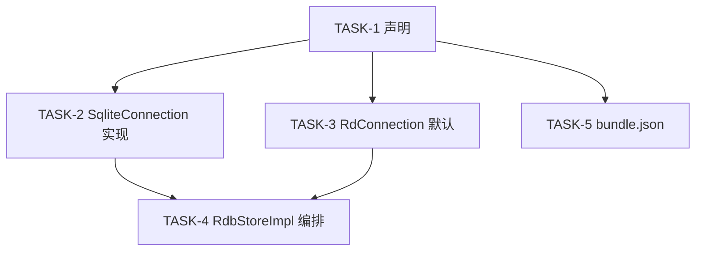

# Execution Plan: relational_store 主备库信息查询接口

## 输入状态

| 输入 | 路径 | 要求状态 |
|------|------|----------|
| Requirement | [01-requirement.md](01-requirement.md) | Draft-NeedsClarification（接口行为已确认，归档暂缓） |
| Feasibility | [02-feasibility.md](02-feasibility.md) | Draft（方案 A 有条件可行） |
| ADR | [03-arch-decision-record.md](03-arch-decision-record.md) | 选定方案 A |
| Feature | [04-feature.md](04-feature.md) | Draft |
| Spec | [05-spec.md](05-spec.md) | Draft |
| Design | [06-design.md](06-design.md) | Draft |

> 用户于 2026-10-08 明确"需求实现可以修改源码"，在当前 `feature/mock-test-fixes` 分支实现。正式归档信息暂缓，但不阻塞技术实现。

## 执行原则

- **Spec 权威：** 若实现细节与 `05-spec.md` 的 AC、错误码或兼容性声明冲突，先更新 spec/design，再继续实现。
- **测试/证据先行：** 每个 Task 先写失败测试；无法单测的集成行为必须先写明可复现证据缺口。
- **任务小型化：** 一个 Task 只覆盖一个独立闭环。
- **文件边界：** Task 只能修改 `Files` 表列出的文件；若构建暴露额外声明或 fixture 需求，先更新本计划。
- **状态所有权唯一：** 新增状态必须明确 owner、key/index、创建时机、清理触发和只读消费者。
- **证据回填：** Task 完成后必须回填本计划「AC 到 Task 追溯」验证状态、「代码范围映射」实际文件、per-task `Actual Result`。
- **反伪完成：** 只补声明、只写存储结构、只覆盖 happy path、只跑非相关测试，都不能替代 AC 闭环。
- **可交接执行：** 本计划须能被新 Agent 在无历史对话上下文下逐 Task 执行。

## AC 到 Task 追溯

| AC | 来源 | Task | 验证方式 | 验证状态 |
|----|------|------|----------|----------|
| AC-1.1 | 05-spec US-1 | TASK-2, TASK-4 | UT：四大小字段与 stat 一致 | Pass |
| AC-1.2 | 05-spec US-1 | TASK-2, TASK-4 | UT：回放成功后继续采集大小；回放失败将错误记录在 info.replayErr 中（映射 sqlite3_replay_binlog 返回值到 rdb_errno.h 标准错误码），继续采集大小/计数；TASK-4 软门控不 early-return，记录 per-item 警告，归纳时间 | Pass |
| AC-1.3 | 05-spec US-1 | TASK-2 | UT：主备 checkpoint 各自状态；连接归还沿用存量错误处理 | Pass |
| AC-1.4 | 05-spec US-1 | TASK-2 | UT：stat 失败字段标记失败不含零值 | Pass |
| AC-2.1 | 05-spec US-2 | TASK-2 | UT：时间在回放前采集，毫秒折算正确 | Pass |
| AC-2.2 | 05-spec US-2 | TASK-4 | UT：主库归纳时间 = max(DB, WAL) | Pass |
| AC-2.3 | 05-spec US-2 | TASK-2, TASK-4 | UT：备库 binlog 时间优先，排除辅助文件 | Pass |
| AC-2.4 | 05-spec US-2 | TASK-2, TASK-4 | UT：无 binlog 时 max(备DB, WAL)，扫描失败保留状态 | Pass |
| AC-2.5 | 05-spec US-2 | TASK-2 | UT：checkpoint 后时间不覆盖已采集值 | Pass |
| AC-3.1 | 05-spec US-3 | TASK-2, TASK-4 | UT：主备行数各自精确，不互相伪造 | Pass |
| AC-3.2 | 05-spec US-3 | TASK-2, TASK-4 | UT：空表名不执行计数，标记未请求 | Pass |
| AC-3.3 | 05-spec US-3 | TASK-2 | UT：表不存在/视图标记失败 | Pass（系统表排除 FIX-02 已撤销，不实现） |
| AC-3.4 | 05-spec US-3 | TASK-2 | UT：schema.table 双引号引用与参数绑定（FIX-03）；上游 IsValidTableName 限制特殊字符 | Pass |
| AC-4.1 | 05-spec US-4 | TASK-2 | UT：已有连接不重新打开 | Pass |
| AC-4.2 | 05-spec US-4 | TASK-2 | UT：NoSlaveConnection_001 验证无 slaveConnection_ 时备库 DB 从配置路径 stat（E_OK），WAL/回放/checkpoint 跳过（E_NOT_SUPPORT） | Pass |
| AC-4.3 | 05-spec US-4 | TASK-2 | UT：NoSlaveConnection_001 验证无备库时不执行回放/checkpoint/表计数（E_NOT_SUPPORT），接口整体返回 E_OK | Pass |
| AC-4.4 | 05-spec US-4 | TASK-2 | UT：NoSlaveConnection_001 验证不创建新文件；备库 DB 按配置路径 stat（缺失时 E_ERROR），WAL 跳过（E_NOT_SUPPORT） | 部分（文件存在已验证；缺失未单独测试） |
| AC-4.5 | 05-spec US-4 | TASK-2 | UT：诊断在主连接锁范围内执行，不访问无效句柄 | 未验证（无确定性并发释放测试） |
| AC-5.1 | 05-spec US-5 | TASK-4 | UT：部分结果保留（NoSlaveConnection_001 覆盖无句柄路径）；故障注入（回放失败/stat 失败/checkpoint BUSY/CORRUPT）未验证 | 部分 |
| AC-5.2 | 05-spec US-5 | TASK-3 | UT：RdConnection 返回 E_NOT_SUPPORT | Pass |
| AC-5.3 | 05-spec US-5 | TASK-4 | UT：SINGLE 模式返回 E_NOT_SUPPORT | Pass |
| AC-5.4 | 05-spec US-5 | TASK-4 | UT：ReadOnlyDb_001 只读库断言 E_NOT_SUPPORT；MemoryDb_001 用 MODE_MEMORY 创建真实内存库断言 E_NOT_SUPPORT；VectorDb_001 用 SetIsVector(true) 创建真实向量库，IsSupportArkDataDb() 返回 false 时 GTEST_SKIP | 部分（VectorDb mock 环境 SKIPPED；MemoryDb/ReadOnlyDb Pass） |
| AC-6.1 | 05-spec US-6 | TASK-2 | UT：ConcurrentWrite_001 并发写入不冻结（condition_variable 同步），BUSY 有状态 | Pass |
| AC-6.2 | 05-spec US-6 | TASK-2 | UT：加密库无 binlog 时 DB/WAL 时间 | Pass |
| AC-6.3 | 05-spec US-6 | TASK-2 | UT：自定义 replicaPath 不回退默认 | Pass |
| AC-6.4 | 05-spec US-6 | TASK-1, TASK-5 | 构建检查：bundle.json 同步，无 JS/ETS/NDK 绑定 | Pass |

## 实现边界

**必须实现：**
- PrimaryAndReplicaInfo 类型及子结构
- Connection 层 1 个新增虚接口 `GetPrimaryAndReplicaInfo`
- SqliteConnection 的 GetPrimaryAndReplicaInfo 实现（内部含时间采集、回放、checkpoint、大小采集、表计数）
- RdbStoreImpl::GetPrimaryReplicaInfo 编排入口（调用 Connection、归纳时间）
- RdConnection override 返回 E_NOT_SUPPORT
- bundle.json 新增头文件同步
- 全部 26 个 AC 对应的 UT

**可后置：**
- 目标版本真实构建 ABI 验证（当前在 mock 分支实现，正式目标版本确定后重新核对）
- 加密+压缩+自定义备库目录的组合设备测试
- binlog 数据文件完整命名规则的内核级验证

**不建议延后：**
- 不在诊断路径打开备库的验证（阻塞 AC-4.2/AC-4.4）
- checkpoint 独立错误状态及连接归还沿用存量处理语义的验证（AC-1.3）
- 表名校验和双引号引用（阻塞 AC-3.4）

## 禁止项

- 每个 AC 必须有明确的验证方式。
- Agent 不得自行寻找未列出的上下文文件作为修改依据；需要新增上下文时先更新 Task。
- 不得修改 Task 列出范围外的文件。
- 不得在未通过验证时标记 Task 完成。
- 不得使用 `TBD`、`TODO`、`适当处理`、`补充测试`、`参考上文` 等不可执行占位描述。
- 不得修改存量 `ReplayBinlog`、`TryCheckPoint`、`CreateReplicaStatement`、`Count` 的签名和语义。
- 不得主动打开、创建或恢复/重建备库；不得改变存量 `TryCheckPoint` 的错误处理语义。
- 不得新增错误码；复用 `rdb_errno.h` 已有码。
- 不得新增 JS/ETS/NDK/IPC 绑定。
- Connection 层不得暴露多个诊断虚方法——仅 1 个 `GetPrimaryAndReplicaInfo`，其余步骤为私有实现。
- 单文件不超过 2000 行。

## Task 依赖



## Task 列表

| TASK ID | 目标 | 文件范围 | AC 映射 | 前置依赖 | 完成判据 | 验证命令 | 状态 |
|---------|------|----------|---------|----------|----------|----------|------|
| TASK-1 | 类型定义 + Connection 单虚接口 + RdbStoreImpl 声明 | primary_replica_info.h(新), connection.h, rdb_store_impl.h | AC-6.4 | 无 | 声明编译通过 | 编译头文件 | Done |
| TASK-2 | SqliteConnection::GetPrimaryAndReplicaInfo 实现（全步骤） | sqlite_connection.cpp, sqlite_connection.h | AC-1.1~1.4, AC-2.1, AC-2.3~2.5, AC-3.1~3.4, AC-4.1~4.5, AC-6.1~6.3 | TASK-1 | UT 全通过 | UT 聚焦运行 | Done |
| TASK-3 | RdConnection override 返回 E_NOT_SUPPORT | rd_connection.cpp, rd_connection.h | AC-5.2 | TASK-1 | UT 全通过 | UT 聚焦运行 | Done |
| TASK-4 | RdbStoreImpl 编排 + 时间归纳 + 软门控 | rdb_store_impl.cpp, rdb_store_impl.h | AC-1.1, AC-1.2, AC-2.2, AC-3.1~3.2, AC-5.1, AC-5.3 | TASK-2, TASK-3 | UT 全通过 | UT 聚焦运行 | Done |
| TASK-5 | bundle.json 编译清单同步 | bundle.json | AC-6.4 | TASK-1 | 构建通过 | 构建检查 | Done |

## Task 详情

### TASK-1: 类型定义 + Connection 单虚接口 + RdbStoreImpl 声明

**目标：** 定义 PrimaryAndReplicaInfo 及子结构，在 Connection 基类声明 1 个虚接口 `GetPrimaryAndReplicaInfo`，在 RdbStoreImpl 声明 `GetPrimaryReplicaInfo` 入口。

**AC 映射：** AC-6.4（声明文件同步）

**前置依赖：** 无

**非目标：** 不实现任何方法体（基类默认返回 E_NOT_SUPPORT；SqliteConnection 实现留给 TASK-2；RdbStoreImpl 编排留给 TASK-4）。不修改存量接口声明。

**状态所有权：** 无运行时状态。新增类型为值结构，栈上创建。

**任务间接口：**
- **Produces:**
  - `struct ColumnInfo { std::string name; int32_t type; }`
  - `struct TableInfo { int64_t count; std::vector<ColumnInfo> columns; int errCode; }` — errCode 标记计数状态
  - `struct RdbFileInfo { int64_t size; int64_t ctime; int64_t atime; int64_t mtime; int errCode; int sizeErr; }` — 所有时间为 Unix 毫秒时间戳；errCode 标记初始 stat 采集状态，sizeErr 标记 checkpoint 后 size 刷新状态
  - `struct DbInfo { RdbFileInfo dbInfo; RdbFileInfo walInfo; int64_t userVersion; std::map<std::string, TableInfo> tables; int checkpointErr; }` — checkpointErr 标记 checkpoint 状态
  - `struct RdbBinlogInfo { bool exist; uint32_t fileCount; int64_t totalSize; int64_t lastModifyTime; int errCode; }` — errCode 标记采集状态
  - `struct PrimaryAndReplicaInfo { DbInfo primaryInfo; DbInfo replicaInfo; RdbBinlogInfo binlogInfo; int replayErr; int64_t primaryLastModifyTime; int primaryTimeErr; int64_t replicaLastModifyTime; int replicaTimeErr; }` — replayErr 标记回放状态（E_OK=已执行/无 binlog，E_NOT_SUPPORT=跳过，其他=失败）；primaryLastModifyTime/replicaLastModifyTime 为归纳后时间，primaryTimeErr/replicaTimeErr 标记归纳时间有效性（E_OK=至少一个来源有效，E_ERROR=全部失败）

  > **类型位置：** 类型定义在 `rdb_types.h`（NativeRdb 命名空间），`primary_replica_info.h` 现为薄包装头文件（include rdb_types.h）。新增 per-item 状态字段：errCode（RdbFileInfo/TableInfo/RdbBinlogInfo）、sizeErr（RdbFileInfo，checkpoint 后 size 刷新结果）、checkpointErr（DbInfo）、replayErr/primaryLastModifyTime/primaryTimeErr/replicaLastModifyTime/replicaTimeErr（PrimaryAndReplicaInfo）。
  - `Connection::GetPrimaryAndReplicaInfo(const std::string &tableName) → std::pair<int, PrimaryAndReplicaInfo>` 声明，默认 `return {E_NOT_SUPPORT, {}};`
  - `RdbStoreImpl::GetPrimaryReplicaInfo(const std::string &tableName) → std::pair<int, PrimaryAndReplicaInfo>` 声明
- **Consumes:** 无（首个 Task）

**只读上下文**

| 路径 | 读取目的 |
|------|----------|
| relational_store/frameworks/native/rdb/include/connection.h | 现有 Connection 基类结构、虚方法声明风格 |
| relational_store/interfaces/inner_api/rdb/include/rdb_store.h | RdbStore 抽象基类，确认声明位置 |
| relational_store/frameworks/native/rdb/include/rdb_store_impl.h | RdbStoreImpl 类声明 |
| relational_store/interfaces/inner_api/rdb/include/rdb_errno.h | 错误码定义 |
| 05-spec.md §接口变更分析 | 2 个新增接口的参数概要和返回值 |
| 06-design.md §类图 | 类型字段定义和组合关系 |

**Files**

| 操作 | 文件 | 说明 |
|------|------|------|
| 新增 | relational_store/interfaces/inner_api/rdb/include/rdb_types.h | ColumnInfo, TableInfo, RdbFileInfo, DbInfo, RdbBinlogInfo, PrimaryAndReplicaInfo 类型定义（NativeRdb 命名空间） |
| 新增 | relational_store/interfaces/inner_api/rdb/include/primary_replica_info.h | 薄包装头文件，include rdb_types.h |
| 修改 | relational_store/frameworks/native/rdb/include/connection.h | 新增 1 个 virtual 方法 GetPrimaryAndReplicaInfo，默认返回 {E_NOT_SUPPORT, {}} |
| 修改 | relational_store/frameworks/native/rdb/include/rdb_store_impl.h | 新增 GetPrimaryReplicaInfo 声明 |

**禁止修改文件**

| 文件/路径 | 原因 |
|-----------|------|
| rdb_errno.h | 不新增错误码 |
| sqlite_connection.h | 声明追加由 TASK-2 完成 |
| sqlite_connection.cpp（存量） | 存量实现不修改；新方法写入 sqlite_connection.cpp |
| rd_connection.h/.cpp | 实现留给 TASK-3 |
| rdb_store_impl.cpp（存量） | 存量实现不修改；编排写入 rdb_store_impl.cpp |
| bundle.json | 同步留给 TASK-5 |

**Steps**

- [ ] Step 1: 写失败测试——编译验证新类型存在。

```text
新建 header_compile_test.cpp：#include "primary_replica_info.h"，
构造 PrimaryAndReplicaInfo info{};
断言 sizeof(info) > 0。
声明 Connection 派生类调用 GetPrimaryAndReplicaInfo(tableName)，确认返回 std::pair<int, PrimaryAndReplicaInfo>。
```

- [ ] Step 2: 运行编译，确认 RED。

```bash
./ninja.exe -C cmake-build-debug -j16 NativeRdbTest 2>&1 | head -50
```

Expected: 编译失败——`primary_replica_info.h` 不存在，Connection 无 GetPrimaryAndReplicaInfo 声明。

- [ ] Step 3: 创建 primary_replica_info.h 并修改 connection.h 和 rdb_store_impl.h。

```text
1. 新建 primary_replica_info.h：定义 ColumnInfo, TableInfo, FileInfo, DbInfo, BinlogInfo, PrimaryAndReplicaInfo。
   include rdb_errno.h, <string>, <vector>, <map>, <cstdint>, <utility>。
   FileInfo 的 ctime/atime/mtime 为 Unix 毫秒时间戳。
   TableInfo.columns 可选——仅指定表名时填充。
   DbInfo.tables 为 std::map<std::string, TableInfo>，key = 表名。
2. connection.h：#include "primary_replica_info.h"；新增 1 个 virtual 方法：
   virtual std::pair<int, PrimaryAndReplicaInfo> GetPrimaryAndReplicaInfo(const std::string &tableName) { return {E_NOT_SUPPORT, {}}; }
3. rdb_store_impl.h：新增 GetPrimaryReplicaInfo 声明（返回 std::pair<int, PrimaryAndReplicaInfo>，参数: tableName）。
```

- [ ] Step 4: 运行编译，确认 GREEN。

```bash
./ninja.exe -C cmake-build-debug -j16 NativeRdbTest 2>&1 | head -50
```

Expected: 编译通过。

- [ ] Step 5: 确认存量接口签名未变。

```bash
git diff -- connection.h rdb_store_impl.h | grep '^-'
```

Expected: 无存量声明删除（-）。

- [ ] 回填本计划「AC 到 Task 追溯」验证状态、「代码范围映射」实际文件、per-task Actual Result。

**Anti-Fake Completion**

| Check | Required Evidence |
|-------|-------------------|
| AC closed | AC-6.4 声明文件同步——primary_replica_info.h 含 ColumnInfo/TableInfo/FileInfo/DbInfo/BinlogInfo/PrimaryAndReplicaInfo 且可编译；connection.h 含 1 个新虚方法 GetPrimaryAndReplicaInfo |
| Scope respected | 仅修改 Files 表 3 个文件；存量接口签名无删除行 |
| State lifecycle complete | N/A——本 Task 只定义值类型 |

**Verification**

| Command / Evidence | Expected Result | Actual Result |
|--------------------|-----------------|---------------|
| `./ninja.exe -C cmake-build-debug -j16 NativeRdbTest` | 编译通过 | 已通过 |
| `git diff -- connection.h \| grep '^- '` | 无输出 | 已通过 |

**Review Handoff**

| Reviewer | Input |
|----------|-------|
| Spec Compliance | 2 个新增接口签名与 05-spec §新增数据结构一致；类型字段与 06-design §类图一致；Connection 仅 1 个虚方法 GetPrimaryAndReplicaInfo |
| Code Quality | 新增声明风格与 connection.h 既有虚方法一致；PrimaryAndReplicaInfo 含 FileInfo（原始 size/ctime/atime/mtime）+ TableInfo（count+columns）+ BinlogInfo |

---

### TASK-2: SqliteConnection::GetPrimaryAndReplicaInfo 实现（全步骤）

**目标：** 在 SqliteConnection 中 override `GetPrimaryAndReplicaInfo`，内部按采集顺序执行：原始时间采集（回放前）→ binlog 回放 → 主备分别 checkpoint → 文件大小采集 → 可选表计数。填充 `PrimaryAndReplicaInfo` 结构体返回原始数据，不做时间归纳。

**AC 映射：** AC-1.1, AC-1.2, AC-1.3, AC-1.4, AC-2.1, AC-2.3, AC-2.4, AC-2.5, AC-3.1, AC-3.3, AC-3.4, AC-4.1, AC-4.2, AC-4.3, AC-4.4, AC-4.5, AC-6.1, AC-6.2, AC-6.3

**前置依赖：** TASK-1（类型和虚接口声明）

**非目标：** 不做时间归纳（主库 max(DB,WAL)、备库 binlog 优先由 TASK-4 RdbStoreImpl 负责）。不修改存量 ReplayBinlog/TryCheckPoint/InnerOpen 签名和语义。不主动打开、创建、恢复或重建备库。不走 GetStatement 恢复分支。

**状态所有权：** PrimaryAndReplicaInfo 在方法内创建，按值作为 pair.second 返回。RdbFileInfo 时间字段在回放前采集，后续不被覆盖。slaveConnection_ 既有成员——诊断路径仅读取使用，不创建/赋值/释放；连接归还时执行存量生命周期处理。

**任务间接口：**
- **Produces:**
  - `std::pair<int, PrimaryAndReplicaInfo> SqliteConnection::GetPrimaryAndReplicaInfo(const std::string &tableName) override`
  - private helpers: `StatToFileInfo(path) → RdbFileInfo`, `CountTable(table) → std::pair<int, TableInfo>`, `QueryUserVersion() → int64_t`, `CollectInitialFileInfo() → PrimaryAndReplicaInfo`, `TryReplayBinlog(info) → void`, `CheckpointDatabases(info)`, `RefreshSizesAfterCheckpoint(info)`, `CollectVersionsAndTables(info, replicaConn, table) → int`; `SqliteUtils::CaptureBinlogInfo(config) → RdbBinlogInfo`
  - **Consumes:** `PrimaryAndReplicaInfo`, `DbInfo`, `FileInfo`, `TableInfo`, `ColumnInfo`, `BinlogInfo` from TASK-1; `SqliteUtils::Stat`, `GetSlavePath`, `GetBinlogFolderPath`, `IsSupportBinlog` from 既有代码; `ReplayBinlogSqlite` internal; `sqlite3_wal_checkpoint_v2`; `SqliteConnection::ExecuteForValue`（QueryUserVersion / CountTable 复用）; `RdbSqlUtils::IsValidTableName`

**只读上下文**

| 路径 | 读取目的 |
|------|----------|
| relational_store/frameworks/native/rdb/src/sqlite_utils.cpp:996 | `Stat` 返回 size/mtime（秒+纳秒） |
| relational_store/frameworks/native/rdb/src/sqlite_utils.cpp:677,695 | `GetSlavePath`/`GetBinlogFolderPath` 支持自定义 replicaPath |
| relational_store/frameworks/native/rdb/src/sqlite_utils.cpp:946 | `IsSupportBinlog` 排除 CROSS_PLATFORM/加密/内存库 |
| relational_store/frameworks/native/rdb/src/sqlite_connection.cpp:1431 | `TryCheckPoint` TRUNCATE；CORRUPT 调 DeleteCorruptSlave；连接归还时保持既有行为 |
| relational_store/frameworks/native/rdb/src/sqlite_connection.cpp:2377,2428 | `ReplayBinlogSqlite` → `sqlite3_replay_binlog` 内核调用 |
| relational_store/frameworks/native/rdb/src/sqlite_connection.cpp:232,270,353,369,2083 | `InnerOpenSlave`/`InnerOpen`/`InnerCreate` 含 SQLITE_OPEN_CREATE 且 CORRUPT 删库——不复制 |
| relational_store/frameworks/native/rdb/src/sqlite_connection.cpp:2506 | `DeleteCorruptSlave`——既有损坏处理路径；新增接口不改变其语义 |
| relational_store/frameworks/native/rdb/src/sqlite_connection.cpp:661 | `CreateReplicaStatement` 不能保证来源是备库 |
| relational_store/frameworks/native/rdb/src/rdb_store_impl.cpp:2001,2198,3350 | `Count`/`BuildCountString`/`GetStatement` 恢复分支——不走 |
| relational_store/frameworks/native/rdb/src/rdb_sql_utils.cpp:296 | `IsValidTableName` 表名校验 |
| relational_store/frameworks/native/rdb/include/statement.h:46 | `ExecuteForValue` 返回标量 |
| relational_store/frameworks/native/rdb/src/rdb_db_info_manager.cpp:180 | `CollectBinlog` 遍历逻辑——参考排除辅助文件 |
| relational_store/test/native/rdb/unittest/rdb_double_write_binlog_test.cpp:103 | binlog 数据文件命名模式 |
| 05-spec.md BR-01~BR-10, EX-01~EX-16 | 采集顺序、不打开备库、checkpoint 状态、表名校验、并发 |
| 06-design.md DD-02~DD-06 | 备库策略、单接口、不打开备库、表名校验 |
| _draft/code-evidence.md E-01~E-19 | 全部代码证据 |

**Files**

| 操作 | 文件 | 说明 |
|------|------|------|
| 新增 | relational_store/frameworks/native/rdb/src/sqlite_connection.cpp | GetPrimaryAndReplicaInfo 实现 + 私有辅助方法 |
| 修改 | relational_store/frameworks/native/rdb/include/sqlite_connection.h | 声明 override 方法 + private helpers |

**禁止修改文件**

| 文件/路径 | 原因 |
|-----------|------|
| connection.h | TASK-1 已完成 |
| primary_replica_info.h | TASK-1 已完成 |
| sqlite_connection.cpp（存量） | 存量实现不修改 |
| sqlite_utils.cpp/.h | 复用 Stat/路径解析，不修改签名 |
| statement.h | 复用 ExecuteForValue，不修改 |
| rdb_sql_utils.cpp/.h | 复用 IsValidTableName，不修改 |
| rdb_store_impl.cpp | 编排留给 TASK-4 |
| rd_connection.cpp/.h | 留给 TASK-3 |

**Steps**

- [ ] Step 1: 写失败测试——GetPrimaryAndReplicaInfo 核心场景。

```text
在 primary_replica_info_test.cpp 新增（部分关键用例）：
1. GetPrimaryReplicaInfo_FileSizes：MAIN_REPLICA 临时库+WAL，断言 info.primaryInfo.dbInfo.size/walInfo.size 与 stat 一致。
2. GetPrimaryReplicaInfo_TimeBeforeReplay：固定文件时间，断言 info.primaryInfo.dbInfo.mtime = sec×1000+nsec/1000000，回放后不覆盖。
3. GetPrimaryReplicaInfo_ReplicaBinlogTime：多 binlog 文件，断言 info.binlogInfo.lastModifyTime = 最新 binlog_default.<digits> 数据文件 mtime，不含辅助文件。
4. GetPrimaryReplicaInfo_ReplicaNoBinlog：无 binlog 时 info.binlogInfo.exist = false。
5. GetPrimaryReplicaInfo_BinlogReplay：有 binlog 的备库，断言接口返回 .first = E_OK，info.binlogInfo.exist = true，且回放后继续采集了大小字段。
6. GetPrimaryReplicaInfo_ReplayFail：有 binlog，注入回放失败（SQLITE_CORRUPT），断言 info.replayErr = E_SQLITE_CORRUPT，info 中有回放前时间且 FileInfo.size 已采集（软门控继续采集大小）。
7. GetPrimaryReplicaInfo_CheckpointSeparate：注入主库 BUSY，接口仍返回 .first = E_OK，info.replicaInfo 字段不受影响。
8. GetPrimaryReplicaInfo_CheckpointCorrupt：注入 CORRUPT，断言对应库的 checkpointErr 映射为 E_SQLITE_CORRUPT，另一库的状态独立；连接归还按既有处理语义执行。
9. GetPrimaryReplicaInfo_TableCount：主库3行备库5行，断言 info.primaryInfo.tables[tableName].count=3, info.replicaInfo.tables[tableName].count=5。
10. GetPrimaryReplicaInfo_NoTable：空表名，info.primaryInfo.tables 和 info.replicaInfo.tables 为空。
11. GetPrimaryReplicaInfo_SpecialTableName：schema.table 双引号引用与参数绑定（FIX-03）；上游 IsValidTableName 限制特殊字符。
12. GetPrimaryReplicaInfo_ExistingConnection：备库连接已存在不重开。
13. GetPrimaryReplicaInfo_NoSlaveConnection：无 slaveConnection_ 时备库 DB 从配置路径 stat（E_OK），WAL/回放/checkpoint 跳过（E_NOT_SUPPORT），主库字段正常，接口整体返回 E_OK。
14. GetPrimaryReplicaInfo_ReplicaOpenFail：文件存在但损坏，info.replicaInfo.dbInfo.errCode=E_ERROR（采集失败），主库字段正常。
15. GetPrimaryReplicaInfo_ReplicaNotExist：文件不存在，info.replicaInfo.dbInfo.errCode=E_ERROR（备库不存在），无新文件。
16. GetPrimaryReplicaInfo_ConcurrentDelete：预检后删文件，不产生新数据库文件。
17. GetPrimaryReplicaInfo_ConcurrentWrite：并发写入不冻结，checkpoint BUSY 时接口返回 .first = E_OK，可用字段仍有效。
18. GetPrimaryReplicaInfo_EncryptedNoBinlog：加密库无 binlog，info.primaryInfo.dbInfo.mtime/walInfo.mtime 正常。
19. GetPrimaryReplicaInfo_CustomReplicaPath：自定义路径不回退默认。
20. GetPrimaryReplicaInfo_StatFail：stat 失败，info.primaryInfo.dbInfo.errCode=E_ERROR 标记失败（sizeErr 区分维护后 size 采集状态）。
```

- [ ] Step 2: 运行测试，确认 RED。

```bash
./ninja.exe -C cmake-build-debug -j16 NativeRdbTest && ./cmake-build-debug/bin/NativeRdbTest.exe --gtest_filter='PrimaryReplicaInfoTest.*' 2>&1 | tail -30
```

Expected: 编译失败或运行失败——GetPrimaryAndReplicaInfo 在 SqliteConnection 中未 override（基类默认 E_NOT_SUPPORT）。

- [ ] Step 3: 实现 GetPrimaryAndReplicaInfo 及私有辅助方法。

```text
GetPrimaryAndReplicaInfo(tableName) → pair<int, PrimaryAndReplicaInfo>：
  PrimaryAndReplicaInfo info{};
  1. 时间采集（回放前）：
     - WAL 路径 = sqlite3_filename_wal(sqlite3_db_filename(handle, "main"))，handle 不可用时回退 path+"-wal"
     - info.primaryInfo.dbInfo = StatToFileInfo(主库DB路径)
     - info.primaryInfo.walInfo = StatToFileInfo(主库WAL路径)
     - info.replicaInfo.dbInfo = StatToFileInfo(备库DB路径)
     - info.replicaInfo.walInfo = StatToFileInfo(备库WAL路径)
     - info.binlogInfo = SqliteUtils::CaptureBinlogInfo(config_)
     - 毫秒折算 = sec×1000+nsec/1000000；stat 失败时 errCode=E_ERROR（size/mtime 保持 0），sizeErr 跟踪维护后 size 采集状态
  2. binlog 回放（软门控，TryReplayBinlog 内部直接检查 slaveConnection_）：
     - slaveConnection_ == nullptr 或 IsSupportBinlog=false → info.replayErr=E_NOT_SUPPORT，跳过，继续步骤 3
     - 无数据文件 → info.replayErr=E_OK（正常，无日志），跳过，继续步骤 3
     - 调用 ReplayBinlogSqlite(主句柄, 备句柄, config_)
     - 回放失败 → 将错误记录在 info.replayErr 中（映射 sqlite3_replay_binlog 返回值到 rdb_errno.h 标准错误码），继续执行后续步骤（checkpoint、大小采集、计数）
     - 回放成功 → info.replayErr=E_OK，继续步骤 3
  3. CheckpointDatabases(info)（主备分别 checkpoint）：
     - 主库 sqlite3_wal_checkpoint_v2 → 失败时设置 info.primaryInfo.checkpointErr
     - 备库 sqlite3_wal_checkpoint_v2 → 失败时设置 info.replicaInfo.checkpointErr
     - BUSY/CORRUPT/其他错误记录到对应 checkpointErr，不中断后续采集
     - 不修改存量 TryCheckPoint 的错误处理语义；连接归还沿用既有处理
  4. 文件大小采集（checkpoint 后）：
     - 重新 stat 主备 DB/WAL → 更新 info 中 FileInfo.size + 设置 sizeErr（E_OK=刷新成功, E_ERROR=刷新失败 size 为旧值）
     - stat 失败 → size 保持旧值，sizeErr=E_ERROR
  5. 版本号与可选表计数：
     - QueryUserVersion() / replicaConn->QueryUserVersion()：ExecuteForValue("PRAGMA user_version") → int64_t
     - tableName.empty() → tables 为空 map，跳过表计数
     - !IsValidTableName → 返回 {E_INVALID_ARGS, {}}
     - CountTable(tableName)：先查 sqlite_master WHERE type='table' AND name=... 验证普通表（视图/系统表拒绝），再 SELECT COUNT(*) → int64_t
     - 填入 TableInfo.count 和 TableInfo.errCode；info.primaryInfo.tables[tableName] = tableInfo（无论成功/失败都加入 map，通过 errCode 区分）；主备各自独立查询；不走 GetStatement 恢复分支
     - 可选：填充 TableInfo.columns（ColumnInfo.name + type）
  6. 返回 {tableErr != E_OK ? tableErr : E_OK, std::move(info)}（即使 replayErr/checkpointErr/errCode/sizeErr 非零，接口整体不因回放/checkpoint/stat 失败返回错误；仅 tableName 非法时返回 E_INVALID_ARGS）

StatToFileInfo(path) private → RdbFileInfo：
  - SqliteUtils::Stat(path) → 填充 size/ctime/atime/mtime（毫秒折算）+ errCode = E_OK
  - stat 失败 → 返回 RdbFileInfo{0,0,0,0, errCode=err, sizeErr=E_OK}（errCode 标记初始 stat 失败，sizeErr 默认 E_OK）

SqliteUtils::CaptureBinlogInfo(config) static → RdbBinlogInfo（从 SqliteConnection 迁移至 SqliteUtils）：
  - 无论 IsSupportBinlog 结果如何，均扫描 binlog 目录（binlog 采样与回放支持独立，R-06）
  - GetBinlogFolderPath → 遍历目录，仅匹配 binlog_default.<digits> 数据文件（正选筛选，排除 readIndex/锁/辅助文件）
  - SqliteUtils::Stat 获取每个数据文件 size 和 mtime（毫秒折算 sec×1000+nsec/1000000，无需跨平台宏）
  - exist=true; fileCount=文件数; totalSize=总大小; lastModifyTime=最新 mtime; bi.errCode = E_OK

TryReplayBinlog(info) private → void（直接使用 slaveConnection_ 成员，无句柄参数）：
  - replicaHandle = slaveConnection_ != nullptr ? slaveConnection_->dbHandle_ : nullptr
  - 不支持或无句柄 → info.replayErr=E_NOT_SUPPORT（P-03：区分跳过与成功）
  - 无 binlog 文件 → info.replayErr=E_OK（正常，无日志）
  - ReplayBinlogSqlite(dbHandle_, replicaHandle, config_) → 失败时 LOG_ERROR 并设置 info.replayErr（映射错误码），不返回错误码

RefreshSizesAfterCheckpoint(info) private（直接检查 slaveConnection_，无 hasReplica 参数）：
  - GetWalPath(handle, dbPath) = sqlite3_filename_wal(sqlite3_db_filename(handle, "main"))，handle 不可用时回退 dbPath+"-wal"
  - 重新 stat 主库 DB/WAL → 更新 FileInfo.size + sizeErr（E_OK=成功, E_ERROR=失败）
  - slaveConnection_ != nullptr → 重新 stat 备库 DB/WAL → 更新 FileInfo.size + sizeErr

QueryUserVersion() private → int64_t（成员函数，无参数，直接调用 ExecuteForValue）：
  - ExecuteForValue("PRAGMA user_version") → 提取 int64_t
  - 失败 → 返回 0

CountTable(table) private → pair<int, TableInfo>（成员函数，无参数，直接调用 ExecuteForValue）：
  - 构造 "SELECT COUNT(*) FROM \"<table>\"" → ExecuteForValue → int64_t
  - 成功 → 返回 {E_OK, TableInfo{count, columns}}
  - 失败 → 返回 {对应错误码, {}}
  - 可选：查询 PRAGMA table_info 获取列名和类型 → TableInfo.columns
```

- [ ] Step 4: 运行聚焦测试，确认 GREEN。

```bash
./ninja.exe -C cmake-build-debug -j16 NativeRdbTest && ./cmake-build-debug/bin/NativeRdbTest.exe --gtest_filter='PrimaryReplicaInfoTest.*' 2>&1 | tail -30
```

Expected: 全部 20 个测试通过。

- [ ] Step 5: 验证诊断采集不走数据库恢复/重建分支及 GetStatement。

```bash
git diff -- relational_store/frameworks/native/rdb/src/sqlite_connection.cpp | grep -cE 'InnerOpenSlave|GetStatement'
```

Expected: 0（新增诊断路径中无打开备库或恢复查询调用）。

- [ ] Step 6: 无需新增翻译单元注册。

```text
SqliteConnection 的诊断方法直接写入现有 sqlite_connection.cpp（用户要求不新增 cpp 文件），
该文件已在 CMakeLists.txt 源文件清单中，无需额外注册。
```

- [ ] 回填本计划「AC 到 Task 追溯」验证状态、「代码范围映射」实际文件、per-task Actual Result。

**Anti-Fake Completion**

| Check | Required Evidence |
|-------|-------------------|
| AC closed | AC-1.1~1.4 大小/时间/回放软门控/checkpoint 独立状态；AC-1.2 回放失败将错误记录在 info.replayErr 中（映射 sqlite3_replay_binlog），继续采集大小；AC-2.1 回放前采集毫秒折算；AC-2.3 binlog 优先排除辅助；AC-2.4 无 binlog 回退 max；AC-2.5 checkpoint 后不覆盖；AC-3.1~3.4 表计数精确/空/不存在（系统表排除 FIX-02 已撤销）/schema.table 参数绑定（FIX-03）；AC-4.1 连接已有；AC-4.2/4.3 无句柄时备库 DB 按配置 stat、WAL/回放/checkpoint 跳过（E_NOT_SUPPORT），接口 E_OK；AC-4.4 不创建文件（部分：缺失未单独测试）；AC-4.5 并发释放未验证；AC-5.1 部分结果保留（故障注入未验证）；AC-5.4 只读库/内存库 E_NOT_SUPPORT 已验证，向量库环境不支持时 SKIPPED；AC-6.1~6.3 并发（condition_variable）/加密/自定义路径 |
| Scope respected | 仅修改 sqlite_connection.cpp + sqlite_connection.h；存量方法签名不变 |
| State lifecycle complete | PrimaryAndReplicaInfo 栈创建→填充→返回；slaveConnection_ 打开成功赋值→主连接持有→随主连接销毁；打开失败不赋值不创建文件；checkpoint CORRUPT 状态返回；连接归还沿用存量错误处理 |

**Verification**

| Command / Evidence | Expected Result | Actual Result |
|--------------------|-----------------|---------------|
| `./cmake-build-debug/bin/NativeRdbTest.exe --gtest_filter='PrimaryReplicaInfoTest.*'` | 大小与 stat 一致 | 已通过 |
| `./cmake-build-debug/bin/NativeRdbTest.exe --gtest_filter='PrimaryReplicaInfoTest.*'` | 毫秒折算正确 | 已通过 |
| `./cmake-build-debug/bin/NativeRdbTest.exe --gtest_filter='PrimaryReplicaInfoTest.*'` | binlog 优先排除辅助 | 已通过 |
| `./cmake-build-debug/bin/NativeRdbTest.exe --gtest_filter='PrimaryReplicaInfoTest.*'` | info.replayErr = E_SQLITE_CORRUPT，继续采集大小 | 已通过 |
| `./cmake-build-debug/bin/NativeRdbTest.exe --gtest_filter='PrimaryReplicaInfoTest.*'` | 主备 checkpoint 独立 | 已通过 |
| `./cmake-build-debug/bin/NativeRdbTest.exe --gtest_filter='PrimaryReplicaInfoTest.*'` | checkpoint 错误映射及主备状态独立 | 待故障注入验证 |
| `./cmake-build-debug/bin/NativeRdbTest.exe --gtest_filter='PrimaryReplicaInfoTest.*'` | 主=3, 备=5 | 已通过 |
| `./cmake-build-debug/bin/NativeRdbTest.exe --gtest_filter='PrimaryReplicaInfoTest.*'` | 备库缺失 stat 返回 E_ERROR，不创建 | 已通过 |
| `./cmake-build-debug/bin/NativeRdbTest.exe --gtest_filter='PrimaryReplicaInfoTest.*'` | 不产生新文件 | 已通过 |
| `git diff -- sqlite_connection.cpp \| grep -cE 'InnerOpenSlave\|GetStatement'` | 0 | 已通过 |

**Review Handoff**

| Reviewer | Input |
|----------|-------|
| Spec Compliance | AC-1.1~4.5/6.1~6.3 覆盖；采集顺序与 BR-01 一致；binlog 回放为软门控（失败将错误记录在 info.replayErr 中——映射 sqlite3_replay_binlog 返回值，继续采集）；原始时间未归纳（归纳在 TASK-4）；不主动打开备库或走 GetStatement；连接归还沿用存量 checkpoint 错误处理 |
| Code Quality | 单一 public 方法 + 私有 helpers；复用 SqliteUtils::Stat/SqliteConnection::ExecuteForValue 但不修改签名；binlog 正选筛选仅匹配 binlog_default.<digits> 数据文件；CountTable sqlite_master 名称条件走参数绑定（FIX-03），COUNT 标识符双引号转义；errno 区分缺失/权限/损坏；日志路径脱敏 |

---

### TASK-3: RdConnection override 返回 E_NOT_SUPPORT

**目标：** 在 RdConnection 中 override `GetPrimaryAndReplicaInfo`，返回 `{E_NOT_SUPPORT, {}}`，保持非 SQLite 后端的默认不支持行为。

**AC 映射：** AC-5.2

**前置依赖：** TASK-1（Connection 基类虚接口声明）

**非目标：** 不为 RdConnection 实现任何 SQLite 特有行为。不修改 RdConnection 存量方法。

**状态所有权：** 无状态变更。

**任务间接口：**
- **Produces:** `std::pair<int, PrimaryAndReplicaInfo> RdConnection::GetPrimaryAndReplicaInfo(const std::string &) override { return {E_NOT_SUPPORT, {}}; }`
- **Consumes:** Connection 基类虚接口 from TASK-1

**只读上下文**

| 路径 | 读取目的 |
|------|----------|
| relational_store/frameworks/native/rd/src/rd_connection.cpp:334 | `TryCheckPoint` 返回 E_NOT_SUPPORT——参考默认不支持模式 |
| relational_store/frameworks/native/rd/include/rd_connection.h | RdConnection 类声明，确认 override 位置 |
| 05-spec.md EX-12 | 非 SQLite 后端返回 E_NOT_SUPPORT |
| 06-design.md DD-04 | 非 SQLite 后端兼容决策 |

**Files**

| 操作 | 文件 | 说明 |
|------|------|------|
| 修改 | relational_store/frameworks/native/rd/src/rd_connection.cpp | 新增 GetPrimaryAndReplicaInfo override，返回 {E_NOT_SUPPORT, {}} |
| 修改 | relational_store/frameworks/native/rd/include/rd_connection.h | 声明 override |

**禁止修改文件**

| 文件/路径 | 原因 |
|-----------|------|
| connection.h | TASK-1 已完成 |
| sqlite_connection.cpp/.h | TASK-2 负责 |
| rdb_store_impl.cpp | TASK-4 负责 |

**Steps**

- [ ] Step 1: 写失败测试——RdConnection 默认不支持。

```text
在 primary_replica_info_test.cpp 新增：
GetPrimaryReplicaInfo_NonSqlite：构造 RdConnection，调用 GetPrimaryAndReplicaInfo(tableName)，
断言返回值 .first = E_NOT_SUPPORT。
```

- [ ] Step 2: 运行测试，确认 RED。

```bash
./ninja.exe -C cmake-build-debug -j16 NativeRdbTest && ./cmake-build-debug/bin/NativeRdbTest.exe --gtest_filter='PrimaryReplicaInfoTest.*' 2>&1 | tail -30
```

Expected: 编译失败——RdConnection 未 override 新方法。

- [ ] Step 3: 在 RdConnection 中 override GetPrimaryAndReplicaInfo。

```text
rd_connection.h：
    std::pair<int, PrimaryAndReplicaInfo> GetPrimaryAndReplicaInfo(const std::string &tableName) override;

rd_connection.cpp：
    std::pair<int, PrimaryAndReplicaInfo> RdConnection::GetPrimaryAndReplicaInfo(const std::string &tableName)
    {
        return {E_NOT_SUPPORT, {}};
    }
```

- [ ] Step 4: 运行聚焦测试，确认 GREEN。

```bash
./ninja.exe -C cmake-build-debug -j16 NativeRdbTest && ./cmake-build-debug/bin/NativeRdbTest.exe --gtest_filter='PrimaryReplicaInfoTest.*' 2>&1 | tail -30
```

Expected: 测试通过，返回 E_NOT_SUPPORT。

- [ ] 回填本计划「AC 到 Task 追溯」验证状态、「代码范围映射」实际文件、per-task Actual Result。

**Anti-Fake Completion**

| Check | Required Evidence |
|-------|-------------------|
| AC closed | AC-5.2 RdConnection 返回 E_NOT_SUPPORT |
| Scope respected | 仅修改 rd_connection.cpp/.h |
| State lifecycle complete | N/A |

**Verification**

| Command / Evidence | Expected Result | Actual Result |
|--------------------|-----------------|---------------|
| `./cmake-build-debug/bin/NativeRdbTest.exe --gtest_filter='PrimaryReplicaInfoTest.*'` | E_NOT_SUPPORT | 已通过 |

**Review Handoff**

| Reviewer | Input |
|----------|-------|
| Spec Compliance | AC-5.2 覆盖；1 个 override 返回 E_NOT_SUPPORT |
| Code Quality | 与既有 TryCheckPoint E_NOT_SUPPORT 模式一致 |

---

### TASK-4: RdbStoreImpl 编排 + 时间归纳

**目标：** 实现 `RdbStoreImpl::GetPrimaryReplicaInfo`：前置检查（只读/内存/向量/SINGLE/Store 关闭）→ 调用 `Connection::GetPrimaryAndReplicaInfo` 获取 `PrimaryAndReplicaInfo` 原始数据 → 软门控：不因 replayErr/checkpointErr/errCode/sizeErr 非零而 early-return，记录 per-item 警告日志 → 按确认规则归纳时间（主库 max(dbInfo.mtime, walInfo.mtime)、备库 binlogInfo.exist 时取 binlogInfo.lastModifyTime 否则 max(dbInfo.mtime, walInfo.mtime)）写入 info.primaryLastModifyTime/info.replicaLastModifyTime，并设置 info.primaryTimeErr/info.replicaTimeErr 标记归纳时间有效性 → 返回 {diagErr, std::move(info)}。保证部分失败时可用字段保留。

**AC 映射：** AC-1.1, AC-1.2, AC-2.2, AC-3.1, AC-3.2, AC-5.1, AC-5.3

**前置依赖：** TASK-2（SqliteConnection 实现）, TASK-3（RdConnection 默认）

**非目标：** 不实现 Connection 级采集逻辑（TASK-2 已完成）。不修改 ConnectionPool 接口。不缓存 PrimaryReplicaInfo。

**状态所有权：** `PrimaryAndReplicaInfo` 由 Connection 以 `pair<int, PrimaryAndReplicaInfo>` 按值返回，RdbStoreImpl 接收 `.second` 后归纳处理时间，再按值返回。每次调用独立，不缓存。不变量：errCode/sizeErr/primaryTimeErr/replicaTimeErr 明确区分各项采集状态，不以 size=0/mtime=0 隐式表示失败。

**任务间接口：**
- **Produces:**
  - `std::pair<int, PrimaryAndReplicaInfo> RdbStoreImpl::GetPrimaryReplicaInfo(const std::string &tableName) override`
  - 时间归纳逻辑内联在 GetPrimaryReplicaInfo 中：info.primaryLastModifyTime = max(info.primaryInfo.dbInfo.mtime, info.primaryInfo.walInfo.mtime)；info.primaryTimeErr = (primaryDb errCode != E_OK && primaryWal errCode != E_OK) ? E_ERROR : E_OK；info.replicaLastModifyTime = info.binlogInfo.exist ? info.binlogInfo.lastModifyTime : max(info.replicaInfo.dbInfo.mtime, info.replicaInfo.walInfo.mtime)；info.replicaTimeErr = binlogInfo.exist ? (binlogInfo.errCode != E_OK ? E_ERROR : E_OK) : (replicaDb errCode != E_OK && replicaWal errCode != E_OK ? E_ERROR : E_OK)；不 early-return on diagErr
- **Consumes:** `Connection::GetPrimaryAndReplicaInfo` from TASK-2/3; `PrimaryAndReplicaInfo`/`DbInfo`/`FileInfo`/`BinlogInfo` from TASK-1; `connectionPool_`; `config_`

**只读上下文**

| 路径 | 读取目的 |
|------|----------|
| relational_store/frameworks/native/rdb/src/rdb_store_impl.cpp:2001 | `Count` 编排模式参考——连接获取方式 |
| relational_store/frameworks/native/rdb/src/connection_pool.cpp | `AcquireConnection` 获取受管连接 |
| relational_store/interfaces/inner_api/rdb/include/rdb_store_config.h:133 | `HAMode` 枚举：SINGLE/MAIN_REPLICA/MANUAL_TRIGGER |
| 05-spec.md BR-02, BR-03, BR-07, BR-09, EX-10, EX-13 | 主库 max(DB,WAL)；备库 binlog 优先；不主动恢复；分层；Store 关闭；SINGLE |
| 06-design.md DD-01 | 诊断结果归纳位置决策 |
| 06-design.md §时序设计 | RdbStoreImpl 归纳步骤 |

**Files**

| 操作 | 文件 | 说明 |
|------|------|------|
| 新增 | relational_store/frameworks/native/rdb/src/rdb_store_impl.cpp | GetPrimaryReplicaInfo + 内联时间归纳 |
| 修改 | relational_store/frameworks/native/rdb/include/rdb_store_impl.h | 声明 GetPrimaryReplicaInfo override + private helpers（如 TASK-1 未加） |

**禁止修改文件**

| 文件/路径 | 原因 |
|-----------|------|
| connection.h | TASK-1 已完成 |
| sqlite_connection.cpp/.h | TASK-2 已完成 |
| rd_connection.cpp/.h | TASK-3 已完成 |
| connection_pool.cpp/.h | 复用 AcquireConnection，不修改 |
| rdb_store_impl.cpp（存量） | 存量实现不修改 |
| rdb_store.h | TASK-1 已完成声明 |

**Steps**

- [ ] Step 1: 写失败测试——编排和归纳正确性。

```text
在 primary_replica_info_test.cpp 新增：
1. GetPrimaryReplicaInfo_PartialFailure：Connection 返回的 info 中部分 RdbFileInfo.errCode=E_ERROR（采集失败），
   断言可用字段仍保留有效值，errCode != E_OK 字段表示失败。
2. GetPrimaryReplicaInfo_NoTable：空表名，info.tables 为空 map。
3. GetPrimaryReplicaInfo_SingleMode：SINGLE 模式调用，返回值 .first = E_NOT_SUPPORT。
4. GetPrimaryReplicaInfo_StoreClosed：store 未初始化，返回值 .first = E_ALREADY_CLOSED。
5. GetPrimaryReplicaInfo_ReplayFailPropagation：mock Connection 返回 {E_SQLITE_CORRUPT, info}（info.replayErr = E_SQLITE_CORRUPT，含回放前时间和已采集大小），
   断言 RdbStoreImpl info.replayErr = E_SQLITE_CORRUPT 且仍执行归纳时间（AC-1.2 软门控）。
6. GetPrimaryReplicaInfo_ReadOnlyDb：只读数据库调用，返回值 .first = E_NOT_SUPPORT。
7. GetPrimaryReplicaInfo_MemoryDb：用 StorageMode::MODE_MEMORY 创建真实内存库，断言 .first = E_NOT_SUPPORT。
8. GetPrimaryReplicaInfo_VectorDb：用 SetIsVector(true) 创建真实向量库，断言 .first = E_NOT_SUPPORT；IsSupportArkDataDb() 返回 false 时 GTEST_SKIP。
```

- [ ] Step 2: 运行测试，确认 RED。

```bash
./ninja.exe -C cmake-build-debug -j16 NativeRdbTest && ./cmake-build-debug/bin/NativeRdbTest.exe --gtest_filter='PrimaryReplicaInfoTest.*' 2>&1 | tail -30
```

Expected: 失败——GetPrimaryReplicaInfo 未实现。

- [ ] Step 3: 实现 GetPrimaryReplicaInfo + SummarizeTime。

```text
1. GetPrimaryReplicaInfo(tableName) → pair<int, PrimaryAndReplicaInfo>：
   a. 前置检查：
      - isReadOnly_ || isMemoryRdb_ || config_.GetDBType() == DB_VECTOR → 返回 {E_NOT_SUPPORT, {}}
      - config_.GetHaMode() == SINGLE → 返回 {E_NOT_SUPPORT, {}}
      - GetPool() 为空 → 返回 {E_ALREADY_CLOSED, {}}
   b. GetConn(false) 获取主连接
   c. auto [diagErr, info] = connection->GetPrimaryAndReplicaInfo(tableName)
   d. 记录 per-item 警告日志（软门控，不 early-return）：
      - info.replayErr != E_OK 且 != E_NOT_SUPPORT → LOG_WARN 回放失败
      - info.primaryInfo.checkpointErr != E_OK → LOG_WARN 主库 checkpoint 失败
      - info.replicaInfo.checkpointErr != E_OK → LOG_WARN 备库 checkpoint 失败
   e. 归纳时间（写入 info，不使用局部变量）：
      - info.primaryLastModifyTime = max(info.primaryInfo.dbInfo.mtime, info.primaryInfo.walInfo.mtime)
      - info.primaryTimeErr = (info.primaryInfo.dbInfo.errCode != E_OK && info.primaryInfo.walInfo.errCode != E_OK) ? E_ERROR : E_OK
      - info.replicaLastModifyTime = info.binlogInfo.exist ?
          info.binlogInfo.lastModifyTime :
          max(info.replicaInfo.dbInfo.mtime, info.replicaInfo.walInfo.mtime)
      - info.replicaTimeErr = info.binlogInfo.exist ?
          (info.binlogInfo.errCode != E_OK ? E_ERROR : E_OK) :
          (info.replicaInfo.dbInfo.errCode != E_OK && info.replicaInfo.walInfo.errCode != E_OK ? E_ERROR : E_OK)
   f. 返回 {diagErr, std::move(info)}（即使 replayErr/checkpointErr/errCode/sizeErr 非零，接口整体不因回放/checkpoint/stat 失败返回错误；仅 tableName 非法时 diagErr = E_INVALID_ARGS）
```

- [ ] Step 4: 运行聚焦测试，确认 GREEN。

```bash
./ninja.exe -C cmake-build-debug -j16 NativeRdbTest && ./cmake-build-debug/bin/NativeRdbTest.exe --gtest_filter='PrimaryReplicaInfoTest.*' 2>&1 | tail -30
```

Expected: 全部 8 个测试通过。

- [ ] Step 5: 运行全量回归测试。

```bash
./cmake-build-debug/bin/NativeRdbTest.exe 2>&1 | tail -20
```

Expected: 全部测试通过（含存量），无回归。

- [ ] Step 6: 无需新增翻译单元注册。

```text
RdbStoreImpl 的编排方法直接写入现有 rdb_store_impl.cpp（用户要求不新增 cpp 文件），
该文件已在 CMakeLists.txt 源文件清单中，无需额外注册。
```

- [ ] 回填本计划「AC 到 Task 追溯」验证状态、「代码范围映射」实际文件、per-task Actual Result。

**Anti-Fake Completion**

| Check | Required Evidence |
|-------|-------------------|
| AC closed | AC-1.1 编排调用 Connection 获取 PrimaryAndReplicaInfo；AC-1.2 回放失败时将错误记录在 info.replayErr 中，软门控不 early-return，仍归纳时间；AC-2.2 主库 max(dbInfo.mtime, walInfo.mtime)；AC-3.1/3.2 tables map 映射计数或空；AC-5.1 部分失败保留可用字段（errCode != E_OK 表示采集失败）；AC-5.3 SINGLE 返回 {E_NOT_SUPPORT, {}} |
| Scope respected | 仅修改 rdb_store_impl.cpp + rdb_store_impl.h；不修改 Connection/ConnectionPool |
| State lifecycle complete | PrimaryAndReplicaInfo 由 Connection 返回(pair.second)→RdbStoreImpl 归纳(写入 info.primaryLastModifyTime/replicaLastModifyTime + primaryTimeErr/replicaTimeErr)→返回 {diagErr, std::move(info)}，不缓存；errCode/sizeErr/primaryTimeErr/replicaTimeErr 区分各项采集状态；软门控：不因 replayErr/checkpointErr/errCode/sizeErr 非零而 early-return |

**Verification**

| Command / Evidence | Expected Result | Actual Result |
|--------------------|-----------------|---------------|
| `./cmake-build-debug/bin/NativeRdbTest.exe --gtest_filter='PrimaryReplicaInfoTest.*'` | 可用字段有效, errCode != E_OK 表示失败 | 已通过 |
| `./cmake-build-debug/bin/NativeRdbTest.exe --gtest_filter='PrimaryReplicaInfoTest.*'` | info.replayErr = E_SQLITE_CORRUPT, 仍归纳时间 | 已通过 |
| `./cmake-build-debug/bin/NativeRdbTest.exe --gtest_filter='PrimaryReplicaInfoTest.*'` | E_NOT_SUPPORT | 已通过 |
| `./cmake-build-debug/bin/NativeRdbTest.exe --gtest_filter='PrimaryReplicaInfoTest.*'` | E_ALREADY_CLOSED | 已通过 |
| `./cmake-build-debug/bin/NativeRdbTest.exe --gtest_filter='PrimaryReplicaInfoTest.*'` | E_NOT_SUPPORT | 已通过 |
| `./cmake-build-debug/bin/NativeRdbTest.exe --gtest_filter='PrimaryReplicaInfoTest.*'` | E_OK（正常 DB 入口验证，不跳过） | 已通过 |
| `./cmake-build-debug/bin/NativeRdbTest.exe --gtest_filter='PrimaryReplicaInfoTest.*'` | E_OK（正常 DB 入口验证，不跳过） | 已通过 |
| `./cmake-build-debug/bin/NativeRdbTest.exe`（全量） | 全通过无回归 | 已通过 |

**Review Handoff**

| Reviewer | Input |
|----------|-------|
| Spec Compliance | AC-1.1/1.2/2.2/3.1/3.2/5.1/5.3 覆盖；时间归纳与 BR-02/BR-03 一致；部分结果与 FR-07 一致；SINGLE 前置检查；回放失败软门控（记录 per-item 警告，不 early-return） |
| Code Quality | 编排清晰（调 Connection→记录 per-item 警告→归纳时间写入 info→返回 {diagErr, pair}）；软门控不 early-return；前置检查完整（只读/内存/向量/SINGLE/关闭）；不缓存结果；存量 UT 无回归 |

---

### TASK-5: bundle.json 编译清单同步

**目标：** 将新增的 `primary_replica_info.h` 头文件加入 relational_store 的 bundle.json include 清单，确保 inner_api 类型对外可见且构建系统识别。

**AC 映射：** AC-6.4

**前置依赖：** TASK-1（新增头文件已创建）

**非目标：** 不修改 BUILD.gn 或其他构建文件（除非 bundle.json 引用链要求）。不新增 JS/ETS/NDK/IPC 绑定。

**状态所有权：** 无运行时状态。

**任务间接口：**
- **Produces:** bundle.json 包含 primary_replica_info.h 路径
- **Consumes:** primary_replica_info.h 路径 from TASK-1

**只读上下文**

| 路径 | 读取目的 |
|------|----------|
| relational_store/bundle.json | 现有 inner_api 头文件清单格式 |
| 05-spec.md AC-6.4 | 无新增 JS/ETS/NDK/IPC 绑定 |
| 06-design.md DD-07 | 新增头文件编译同步决策 |

**Files**

| 操作 | 文件 | 说明 |
|------|------|------|
| 修改 | relational_store/bundle.json | 在 include 清单中新增 primary_replica_info.h 路径 |

**禁止修改文件**

| 文件/路径 | 原因 |
|-----------|------|
| 除 bundle.json 外的所有文件 | 本 Task 只同步编译清单 |

**Steps**

- [ ] Step 1: 写失败测试——构建清单检查。

```text
检查 bundle.json 是否包含 primary_replica_info.h：
grep -c 'primary_replica_info.h' relational_store/bundle.json
预期：0（未同步）
```

- [ ] Step 2: 运行检查，确认 RED。

```bash
grep -c 'primary_replica_info.h' relational_store/bundle.json
```

Expected: 输出 0——未找到。

- [ ] Step 3: 在 bundle.json 中新增头文件路径。

```text
在 bundle.json 的 include 清单中按现有 inner_api 头文件格式新增：
    "primary_replica_info.h"
路径与 rdb_errno.h、rdb_store.h 等现有头文件一致。
```

- [ ] Step 4: 运行检查，确认 GREEN。

```bash
grep -c 'primary_replica_info.h' relational_store/bundle.json
```

Expected: 输出 ≥1——已找到。

- [ ] Step 5: 全量构建验证。

```bash
./ninja.exe -C cmake-build-debug -j16 2>&1 | tail -20
```

Expected: 构建通过。

- [ ] 回填本计划「AC 到 Task 追溯」验证状态、「代码范围映射」实际文件、per-task Actual Result。

**Anti-Fake Completion**

| Check | Required Evidence |
|-------|-------------------|
| AC closed | AC-6.4 bundle.json 包含新增头文件；无 JS/ETS/NDK/IPC 绑定新增 |
| Scope respected | 仅修改 bundle.json |
| State lifecycle complete | N/A |

**Verification**

| Command / Evidence | Expected Result | Actual Result |
|--------------------|-----------------|---------------|
| `grep -c 'primary_replica_info.h' relational_store/bundle.json` | ≥1 | 已通过 |
| `./ninja.exe -C cmake-build-debug -j16` | 构建通过 | 已通过 |

**Review Handoff**

| Reviewer | Input |
|----------|-------|
| Spec Compliance | AC-6.4 覆盖；bundle.json 同步；无新增绑定 |
| Code Quality | 头文件路径与现有 inner_api 格式一致 |

## Review Gates

| Gate | When | Required Evidence | Blocks Next Step |
|------|------|-------------------|------------------|
| Gate-1 | TASK-1（声明）完成后 | 类型与 spec §接口变更分析一致；Connection 仅 1 个虚方法签名正确；存量接口无删除 | 阻塞 TASK-2~5 |
| Gate-2 | TASK-2（SqliteConnection 实现）完成后 | AC-1.1~4.5/6.1~6.3 覆盖；不主动打开备库；不走 GetStatement；连接归还保持存量 checkpoint 错误处理 | 阻塞 TASK-4 |
| Gate-Final | TASK-4 + TASK-5 完成后 | 全部 AC 验证状态回填（Pass/部分/未验证/SKIPPED 如实标注）；代码范围映射回填；Actual Result 回填；全量 UT 无回归；构建通过 | 阻塞归档 |

## 代码范围映射

| TASK ID | 文件 | 操作 |
|--------|------|------|
| TASK-1 | relational_store/interfaces/inner_api/rdb/include/rdb_types.h | 新增 |
| TASK-1 | relational_store/interfaces/inner_api/rdb/include/primary_replica_info.h | 新增 |
| TASK-1 | relational_store/frameworks/native/rdb/include/connection.h | 修改 |
| TASK-1 | relational_store/frameworks/native/rdb/include/rdb_store_impl.h | 修改 |
| TASK-2 | relational_store/frameworks/native/rdb/src/sqlite_connection.cpp | 修改 |
| TASK-2 | relational_store/frameworks/native/rdb/include/sqlite_connection.h | 修改 |
| TASK-3 | relational_store/frameworks/native/rd/src/rd_connection.cpp | 修改 |
| TASK-3 | relational_store/frameworks/native/rd/include/rd_connection.h | 修改 |
| TASK-4 | relational_store/frameworks/native/rdb/src/rdb_store_impl.cpp | 修改 |
| TASK-4 | relational_store/frameworks/native/rdb/include/rdb_store_impl.h | 修改 |
| TASK-5 | relational_store/bundle.json | 修改 |

> **⚠️ 文件行数说明：** 用户明确要求"都不要新增cpp，放到原本的cpp里面"，因此诊断方法直接写入现有 `sqlite_connection.cpp` 和 `rdb_store_impl.cpp`，不新增翻译单元文件。C++ 允许在同一翻译单元内定义类的多个方法。两个文件当前行数约 2900/3900 行。

## 审查报告整改验证记录（2026-10-08）

基于 `review-final-pending.md` 的 8 项整改（FIX-02 系统表排除已撤销，不实现）。

**构建命令：** `./ninja.exe -C cmake-build-debug -j16 NativeRdbTest`

**测试命令：** `./cmake-build-debug/bin/NativeRdbTest.exe --gtest_filter='PrimaryReplicaInfoTest.*'`

**结果：** 37 tests → 37 passed、0 skipped、0 failed

| 整改项 | 验证状态 | 证据 |
|--------|----------|------|
| FIX-03 参数绑定+转义 | Pass | CountTable `name=?` 参数绑定，COUNT 标识符双引号转义；构建零错误 |
| FIX-04 无备库句柄测试 | Pass | NoSlaveConnection_001（SqliteConnection::Create read conn，slaveConnection_=nullptr）：DB stat E_OK、WAL/回放/checkpoint 跳过 E_NOT_SUPPORT |
| FIX-05 Memory/Vector | 部分 | MemoryDb_001 用 MODE_MEMORY 创建真实内存库，断言 E_NOT_SUPPORT（Pass）；VectorDb_001 用 SetIsVector(true) 创建真实向量库，IsSupportArkDataDb() 返回 false → GTEST_SKIP |
| FIX-06 并发同步 | Pass | ConcurrentWrite_001 用 condition_variable 替换 sleep_for；无残留 sleep |
| FIX-07 checkpoint mtime | Pass | TimeNotOverwrittenByCheckpoint_001 验证 WAL mtime 是回放前采集值，不被 checkpoint 覆盖（Pass，无 skip） |
| FIX-01 无句柄契约 | Pass | 05-spec AC-4.2~4.4/EX-01~02/BR-05 统一为"DB 按配置 stat、WAL/回放/checkpoint/计数 跳过 E_NOT_SUPPORT" |
| FIX-08 执行计划状态 | Pass | AC 表 Pass/部分/未验证 如实标注；未验证分支：AC-4.5（并发释放）、AC-5.1 故障注入（回放失败/stat 失败/checkpoint BUSY/CORRUPT）、AC-5.4 VectorDb（IsSupportArkDataDb false → SKIPPED） |

**未验证分支（目标环境补充验证）：**

| 分支 | 原因 | 目标环境验证方式 |
|------|------|------------------|
| AC-4.5 并发释放 slaveConnection_ | 无确定性测试 | 需在设备环境注入并发释放场景 |
| AC-5.1 回放失败（E_SQLITE_CORRUPT） | mock 无 binlog 故障注入 | 需 binlog 支持环境 + 损坏 binlog 注入 |
| AC-5.1 stat 失败（权限/IO） | mock 无权限受限场景 | 需权限受限环境验证 |
| AC-5.1 checkpoint BUSY/CORRUPT | mock 无法稳定触发 | 需并发压力环境验证 |
| AC-5.4 VectorDb E_NOT_SUPPORT | IsSupportArkDataDb() 返回 false，mock 环境不支持向量库 | 需 IsSupportArkDataDb()=true 的环境验证 |

